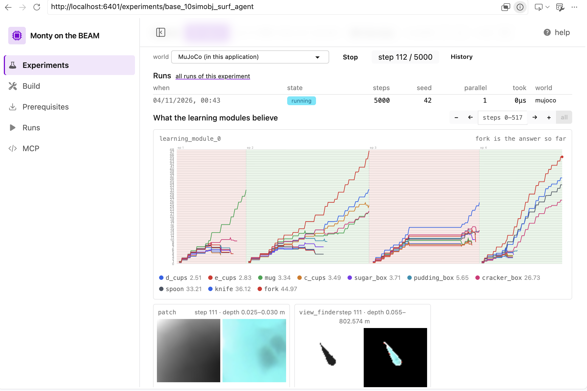
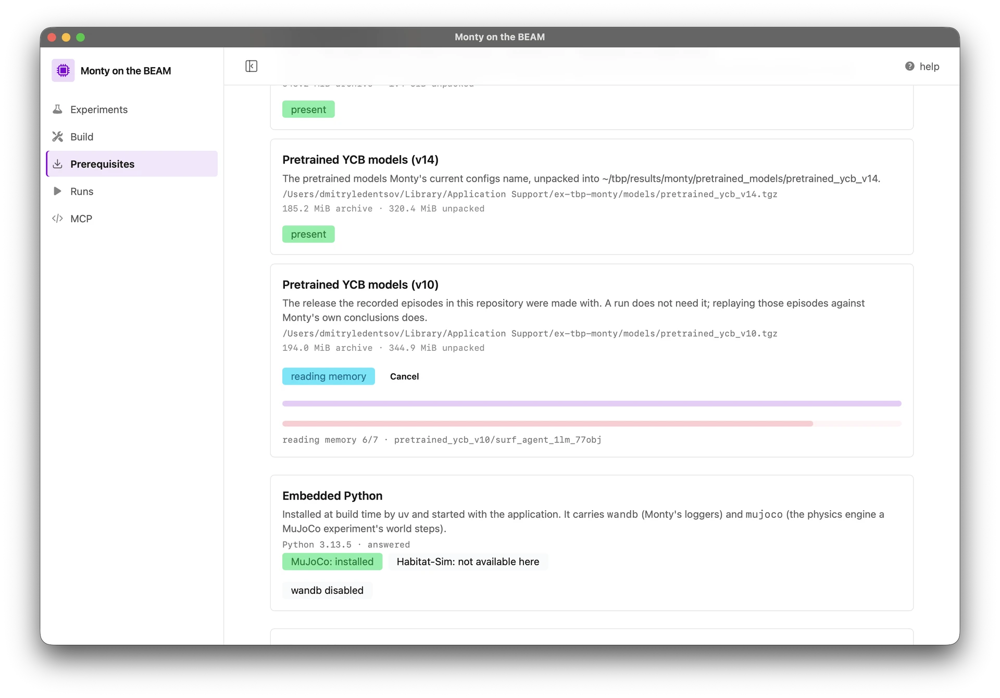

# Monty on the BEAM

[Monty](https://github.com/thousandbrainsproject/tbp.monty) is the Thousand
Brains Project's system: a sensor module moves over an object, learning modules
model it, and the model says where the sensor is on it.

This is that system rewritten in Elixir, with one idea behind it: **run Monty's
experiments with a couple of clicks, install nothing, and reach Monty's
documentation through an MCP.**

<p>
  
  
</p>

The port is module for module, and checked against Monty's own numbers —
[what is ported](docs/features.md), [what was compared](docs/validation.md),
[what differs](docs/monty-differences.md).

## Start

**In a browser, with Docker.** One file, one command, no database to set up:

```bash
curl -fsSLO https://raw.githubusercontent.com/d-led/ex.tbp.monty/main/docker-compose.quickstart.yml
docker compose -f docker-compose.quickstart.yml up
```

→ <http://localhost:6401>

The image is `ghcr.io/d-led/ex.tbp.monty:latest` (amd64 and arm64). It migrates
itself as it boots and keeps its database, downloads and run records on named
volumes: `down` keeps them, `down -v` deletes them.

To run against Postgres, use
[docker-compose.postgres.yml](docker-compose.postgres.yml). To run the image
against a Postgres you already have, see [docs/container.md](docs/container.md).

**As an app, nothing installed.** The same studio in a native window, with its
own server inside — no Docker, no Elixir:

```bash
# macOS (Apple Silicon) and Linux (x86-64)
curl -fsSL https://raw.githubusercontent.com/d-led/ex.tbp.monty/main/scripts/run-desktop.sh | bash
```

```powershell
# Windows
powershell -ExecutionPolicy Bypass -Command "irm https://raw.githubusercontent.com/d-led/ex.tbp.monty/main/scripts/run-desktop.ps1 | iex"
```

It unpacks the newest build of `main` into `./ex-tbp-monty-<platform>/` and opens
it. Delete that folder to remove it. Run it again to open what is there, or pass
`--update` (`$env:EX_TBP_MONTY_UPDATE = 1` on Windows) for the newest build. A
tagged release keeps the same file on its releases page. Or take the file
yourself:

| Platform    | Download                                                                                                       |
| ----------- | -------------------------------------------------------------------------------------------------------------- |
| macOS arm64 | [ex-tbp-monty-osx-arm64](https://nightly.link/d-led/ex.tbp.monty/workflows/ci/main/ex-tbp-monty-osx-arm64.zip) |
| Linux x64   | [ex-tbp-monty-linux-x64](https://nightly.link/d-led/ex.tbp.monty/workflows/ci/main/ex-tbp-monty-linux-x64.zip) |
| Windows x64 | [ex-tbp-monty-win-x64](https://nightly.link/d-led/ex.tbp.monty/workflows/ci/main/ex-tbp-monty-win-x64.zip)     |

Those are the three builds the workflow makes. Intel Macs and arm64 Linux build
their own: `scripts/package.sh osx-x64` and `scripts/package.sh linux-arm64`. A
checkout opens the window with `scripts/start-desktop.sh`. The macOS app is
unsigned, so its first launch is right-click → Open. What each download holds,
and why it is larger than the app (mostly the Python interpreter the release
carries), is in [docs/desktop.md](docs/desktop.md).

## From source

```bash
scripts/init-dev.sh    # Postgres on 6432, dependencies, database, assets
scripts/run-dev.sh     # http://localhost:4000
```

A release and the desktop app keep their data in a SQLite file unless
`DATABASE_URL` names a server —
[docs/developers.md](docs/developers.md#a-file-instead-of-a-server).

You need Elixir 1.20, node/npm, Docker and a Rust toolchain. The first and the
last install themselves when the machine has neither:

```bash
scripts/install-elixir.sh    # Elixir 1.20.5 + OTP 29.1, per user, no root
scripts/install-rust.sh      # the Rust toolchain
```

Both take no arguments and do nothing where their toolchain is already there.
Rust is a _build_ requirement only: the native kernels compile with the app, and
the release carries them. Tests, the gates CI runs, and how to add a module:
[docs/developers.md](docs/developers.md).

## Then what

Open **Experiments**, pick one, press **Run it**. The page shows the config as
Monty wrote it and as this app composes it. Then it streams the run: evidence
over steps, the hypothesis space, both camera views, and where the agent is on
the object. Every run is recorded and replays step by step.

If files are missing, **Prerequisites** names them and fetches them in one click.
An experiment built from a class this port has not written is refused, and the
page names the class. A stand-in would be a different experiment.

## Three ways in

- **The studio**, above: a page per experiment, runs kept and replayable.
- **An assistant**, through `/mcp`: ask about Monty's theory, roadmap and code;
  preview, save and run experiments. `http://localhost:4001/mcp` is already in
  [`.vscode/mcp.json`](.vscode/mcp.json). Start the dev server with `PORT=4001`,
  or copy the address `/mcp/config` prints — [docs/mcp.md](docs/mcp.md).
- **A terminal**: the same run record without a browser, and a measurement of it:

```bash
mix monty.run base_config_10distinctobj_dist_agent --episodes 1 --steps 8
mix monty.bench base_config_10distinctobj_dist_agent --steps 5
```

Flags and what each prints: [docs/features.md](docs/features.md).

## How it follows Monty

- **The same modules.** Python `path/file.py::Class` becomes
  `Monty.Path.File.Class` by one rule, with nothing renamed to suit Elixir —
  [`packages/ex_tbp_monty_core/lib/monty/module_map/data.ex`](packages/ex_tbp_monty_core/lib/monty/module_map/data.ex),
  checked by `mix monty.module_map.verify`.
- **The same configs.** Monty's Hydra YAML is read unchanged from
  [`priv/monty`](priv/monty), so no Monty checkout is needed; every experiment
  Monty snapshots composes to the same tree here —
  [docs/config-compatibility.md](docs/config-compatibility.md).
- **Processes, not a loop.** A step is a barrier over processes: sensor modules,
  learning modules and the motor system exchange CMP messages. A vote is a round
  with a deadline — [docs/architecture.md](docs/architecture.md).
- **MuJoCo is the world a run steps.** Monty's own simulator is copied into
  `priv/monty_py` rather than ported, and runs in the interpreter the release
  carries. The Elixir stand-in scene is the alternative. Habitat is not carried:
  a Habitat config is refused rather than given MuJoCo's scene and allowed to
  look as if it ran — [docs/simulator-port.md](docs/simulator-port.md).
- **Checked against Monty.** [docs/validation.md](docs/validation.md) says what
  was compared and with which numbers;
  [docs/features.md](docs/features.md) says what is ported.

## Where it differs

Monty steps one object graph in one loop. Here every module is a process. Voting
is a round with a deadline, a dead module is replaced mid-step, each module draws
from its own seeded stream, and state is returned rather than mutated. What
follows from that, and what looks wrong upstream, is in
[docs/monty-differences.md](docs/monty-differences.md).

## Docs

Four kinds of page, one folder: [docs/README.md](docs/README.md).

| Kind             | Answers                                                                     |
| ---------------- | --------------------------------------------------------------------------- |
| Learn it         | how do I get from nothing to a finished run?                                |
| Do a task        | how do I run the image, the app, a cluster, a plugin?                       |
| Look up a fact   | is this ported, which config keys, which tools, which experiments run here? |
| Understand why   | what is Monty's model, and where does this port disagree?                   |
| Work on the code | [docs/developers.md](docs/developers.md): invariants, tests, gates          |

## Citation

What this port follows is described in the papers below. If you use it in your
work, cite them. The port itself is citable too: [`CITATION.cff`](CITATION.cff)
is what GitHub's _Cite this repository_ button reads, and Zenodo mints a DOI for
each release.

```bibtex
@article{leadholm2026thousandbrains,
  title   = {Thousand-Brains Systems: Sensorimotor Intelligence for Rapid, Robust Learning and Inference},
  author  = {Leadholm, Niels and Clay, Viviane and Knudstrup, Scott and Lee, Hojae and Hawkins, Jeff},
  journal = {Neural Computation},
  year    = {2026},
  doi     = {10.1162/neco.a.1508}
}

@article{clay2024thousandbrains,
  title   = {The Thousand Brains Project: A New Paradigm for Sensorimotor Intelligence},
  author  = {Clay, Viviane and Leadholm, Niels and Hawkins, Jeff},
  journal = {arXiv preprint arXiv:2412.18354},
  year    = {2024},
  url     = {https://arxiv.org/abs/2412.18354}
}

@article{hawkins2019framework,
  title   = {A Framework for Intelligence and Cortical Function Based on Grid Cells in the Neocortex},
  author  = {Hawkins, Jeff and Lewis, Marcus and Klukas, Mirko and Purdy, Scott and Ahmad, Subutai},
  journal = {Frontiers in Neural Circuits},
  volume  = {12},
  pages   = {121},
  year    = {2019},
  doi     = {10.3389/fncir.2018.00121}
}
```

## Licence

MPL-2.0 — see [LICENSE](LICENSE). Monty itself is MIT-licensed. This project
copies Monty's config tree verbatim, and the snapshots our composer is checked
against. Those files stay Monty's, with its licence beside them in
[priv/monty/LICENSE](priv/monty/LICENSE).

Everything else third-party is a dependency, not a copy, and each fetched package
keeps its licence. The build files are the list:

- Elixir libraries in [`mix.exs`](mix.exs), pinned in [`mix.lock`](mix.lock)
- browser packages in [`assets/package.json`](assets/package.json)
- Python in [`config/pythonx.exs`](config/pythonx.exs)
- the NIFs and the window in
  [`packages/ex_tbp_monty_core/native`](packages/ex_tbp_monty_core/native) and
  [`src-tauri/Cargo.toml`](src-tauri/Cargo.toml)
- the image's base images in the [Dockerfile](Dockerfile)
