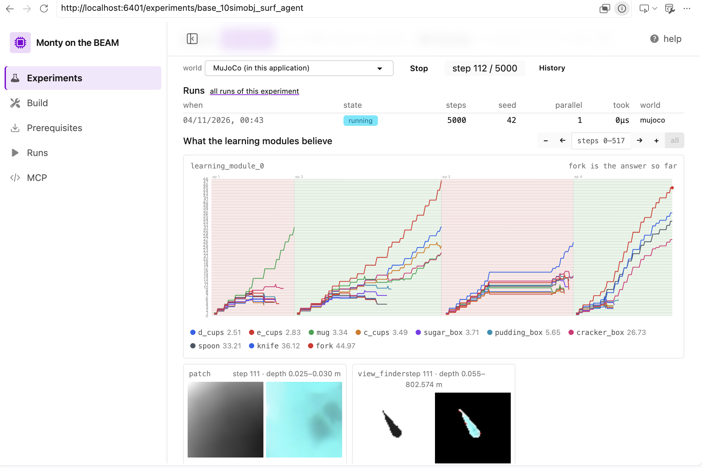
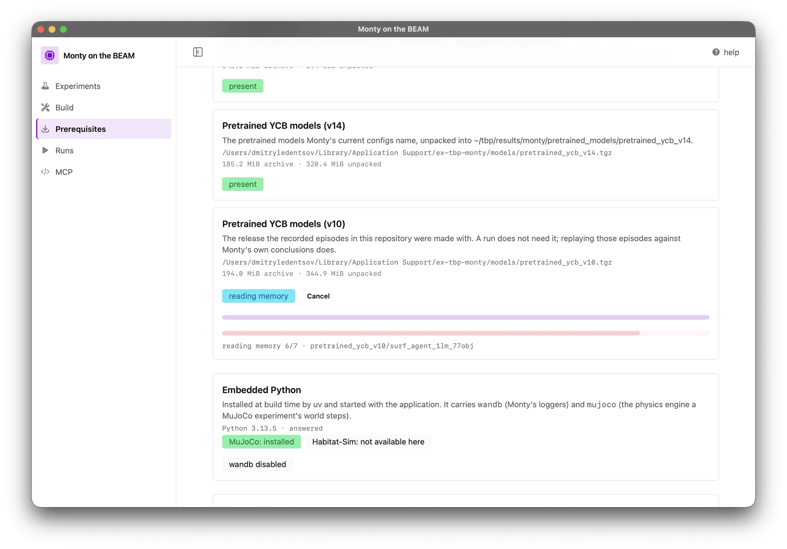

# Monty on the BEAM

[Monty](https://github.com/thousandbrainsproject/tbp.monty) is the Thousand
Brains Project's system: a sensor module moves over an object, learning modules
model it, and the model says where the sensor is on it.

This is that system rewritten in Elixir, with one idea behind it: **run Monty's
experiments with a couple of clicks, install nothing, and reach Monty's
documentation through an MCP.**

<p>
  
  
</p>

The port is module for module, and checked against Monty's own numbers —
[what is ported](docs/features.md), [what was compared](docs/validation.md),
[what differs](docs/monty-differences.md).

## Start

**In a browser, with Docker.** One file, one command, no database to set up:

```bash
curl -fsSLO https://raw.githubusercontent.com/d-led/ex.tbp.monty/main/docker-compose.quickstart.yml
docker compose -f docker-compose.quickstart.yml up
```

→ <http://localhost:6401>

The image is `ghcr.io/d-led/ex.tbp.monty:latest` (amd64 and arm64): it migrates
itself as it boots, and keeps its database, its downloads and its run records on
named volumes, so `docker compose down` keeps them and `down -v` deletes them.

A server-backed stack is the same file with `postgres` in the name
([docker-compose.postgres.yml](docker-compose.postgres.yml)). The image alone,
against a Postgres you already have, is in [docs/container.md](docs/container.md)
with every variable and the one writable directory.

**As an app, nothing installed.** The same studio in a native window, with its
own server inside — no Docker, no Elixir:

```bash
# macOS (Apple Silicon) and Linux (x86-64)
curl -fsSL https://raw.githubusercontent.com/d-led/ex.tbp.monty/main/scripts/run-desktop.sh | bash
```

```powershell
# Windows
powershell -ExecutionPolicy Bypass -Command "irm https://raw.githubusercontent.com/d-led/ex.tbp.monty/main/scripts/run-desktop.ps1 | iex"
```

It unpacks the newest build of `main` into `./ex-tbp-monty-<platform>/` and opens
it; deleting that folder is the whole of removing it, and running it again opens
what is there (`--update` on macOS and Linux, `$env:EX_TBP_MONTY_UPDATE = 1` on
Windows, for the newest build again). A tagged release keeps the same file in the
releases page. Or take the file yourself:

| Platform    | Download                                                                                                       |
| ----------- | -------------------------------------------------------------------------------------------------------------- |
| macOS arm64 | [ex-tbp-monty-osx-arm64](https://nightly.link/d-led/ex.tbp.monty/workflows/ci/main/ex-tbp-monty-osx-arm64.zip) |
| Linux x64   | [ex-tbp-monty-linux-x64](https://nightly.link/d-led/ex.tbp.monty/workflows/ci/main/ex-tbp-monty-linux-x64.zip) |
| Windows x64 | [ex-tbp-monty-win-x64](https://nightly.link/d-led/ex.tbp.monty/workflows/ci/main/ex-tbp-monty-win-x64.zip)     |

Those are the three builds the workflow makes; Intel Macs and arm64 Linux build
their own (`scripts/package.sh osx-x64`, `scripts/package.sh linux-arm64`), and a
checkout opens the window with `scripts/start-desktop.sh`. The macOS app is
unsigned, so its first launch is right-click → Open. What each download holds,
and why it is larger than the app — mostly the Python interpreter the release
carries — is in [docs/desktop.md](docs/desktop.md).

## From source

```bash
scripts/init-dev.sh    # Postgres on 6432, dependencies, database, assets
scripts/run-dev.sh     # http://localhost:4000
```

A release and the desktop app keep their data in a SQLite file unless
`DATABASE_URL` names a server —
[docs/developers.md](docs/developers.md#a-file-instead-of-a-server).

Needs Elixir 1.20, node/npm, Docker, and a Rust toolchain — and installs the
first and the last itself when the machine has neither:

```bash
scripts/install-elixir.sh    # Elixir 1.20.5 + OTP 29.1, per user, no root
scripts/install-rust.sh      # the Rust toolchain
```

Both take no arguments and do nothing where their toolchain is already there;
Rust is a _build_ requirement only — the native kernels compile with the app and
the release carries them. Tests, the gates CI runs, and how a module is added:
[docs/developers.md](docs/developers.md).

## Then what

Open **Experiments**, pick one, press **Run it**. The page shows the config as
Monty wrote it and as this app composes it, then streams the run: evidence over
steps, the hypothesis space, both camera views, and where the agent is on the
object. Every run is recorded, and replays step by step.

If the page says files are missing, **Prerequisites** names them and fetches them
in one click. An experiment built from a class this port has not written is
refused, and the page names the class — a stand-in would be a different
experiment.

## Three ways in

- **The studio**, above: a page per experiment, runs kept and replayable.
- **An assistant**, through `/mcp`: ask about Monty's theory, roadmap and code,
  and preview, save and run experiments. `http://localhost:4001/mcp` is already in
  [`.vscode/mcp.json`](.vscode/mcp.json) — start the dev server with `PORT=4001`,
  or copy the address `/mcp/config` prints — [docs/mcp.md](docs/mcp.md).
- **A terminal**: the same run record without a browser, and a measurement of it:

```bash
mix monty.run base_config_10distinctobj_dist_agent --episodes 1 --steps 8
mix monty.bench base_config_10distinctobj_dist_agent --steps 5
```

Flags and what each prints: [docs/features.md](docs/features.md).

## How it follows Monty

- **The same modules.** Python `path/file.py::Class` becomes
  `Monty.Path.File.Class` by one rule, with nothing renamed to suit Elixir —
  [`lib/monty/module_map/data.ex`](lib/monty/module_map/data.ex), checked by
  `mix monty.module_map.verify`.
- **The same configs.** Monty's Hydra YAML is read unchanged from
  [`priv/monty`](priv/monty), so no Monty checkout is needed; every experiment
  Monty snapshots composes to the same tree here —
  [docs/config-compatibility.md](docs/config-compatibility.md).
- **Processes, not a loop.** A step is a barrier over processes: sensor modules,
  learning modules and the motor system exchange CMP messages, and a vote is a
  round with a deadline — [docs/architecture.md](docs/architecture.md).
- **MuJoCo is the world a run steps.** Monty's own simulator, copied into
  `priv/monty_py` rather than ported, driven in the interpreter the release
  carries; the Elixir stand-in scene is the alternative. Habitat is not carried —
  a Habitat config is refused rather than given MuJoCo's scene and allowed to look
  as if it ran — [docs/simulator-port.md](docs/simulator-port.md).
- **Checked against Monty.** What was compared, with which numbers, is
  [docs/validation.md](docs/validation.md); what is ported is measured in
  [docs/features.md](docs/features.md).

## Where it differs

Monty steps one object graph in one loop; here every module is a process. Voting
is a round with a deadline, a module that dies is replaced while the step goes on,
each module draws from its own seeded stream, and state is returned rather than
mutated. What follows from that, and what looks wrong upstream, is in
[docs/monty-differences.md](docs/monty-differences.md).

## Docs

| Doc                                                          | Answers                                                              |
| ------------------------------------------------------------ | -------------------------------------------------------------------- |
| [docs/features.md](docs/features.md)                         | what works, and what proves it                                       |
| [docs/architecture.md](docs/architecture.md)                 | what happens in one timestep?                                        |
| [docs/module-map.md](docs/module-map.md)                     | where is that Python file here?                                      |
| [docs/from-monty.md](docs/from-monty.md)                     | what comes from Monty, where it lands, and the task that writes it   |
| [docs/config-compatibility.md](docs/config-compatibility.md) | which Hydra features are implemented, and how far parity goes        |
| [docs/validation.md](docs/validation.md)                     | what has been compared with Monty, and how closely                   |
| [docs/monty-differences.md](docs/monty-differences.md)       | every deliberate difference, and what looks wrong upstream           |
| [docs/simulator-port.md](docs/simulator-port.md)             | where the world lives, and what is still Python                      |
| [docs/developers.md](docs/developers.md)                     | how do I work on this?                                               |
| [docs/container.md](docs/container.md)                       | how do I run the image? every variable, the volumes, what it reports |
| [docs/desktop.md](docs/desktop.md)                           | how do I open this as an app? the window, the folder it writes to    |
| [docs/mcp.md](docs/mcp.md)                                   | `POST /mcp` — ask this app about Monty's docs, roadmap and code      |
| [docs/roadmap.md](docs/roadmap.md)                           | the order the rest of Monty arrives in                               |

## Licence

MPL-2.0 — see [LICENSE](LICENSE). Monty itself is MIT-licensed, and this project
ships a verbatim copy of its config tree and of the snapshots our composer is
checked against: those files stay Monty's, with its licence beside them in
[priv/monty/LICENSE](priv/monty/LICENSE).

Everything else third-party here is a dependency rather than a copy, so the build
files are the list — each fetched package keeps its licence: Elixir libraries in
[`mix.exs`](mix.exs) (pinned in [`mix.lock`](mix.lock)), browser packages in
[`assets/package.json`](assets/package.json), Python in
[`config/pythonx.exs`](config/pythonx.exs), the NIFs and the window in
[`native/`](native) and [`src-tauri/Cargo.toml`](src-tauri/Cargo.toml), and the
image's base images in the [Dockerfile](Dockerfile).
