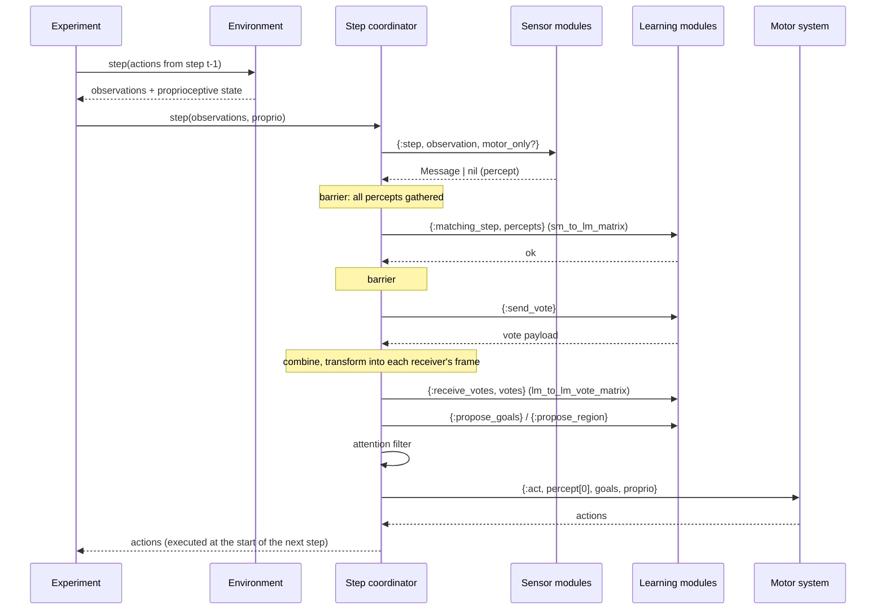
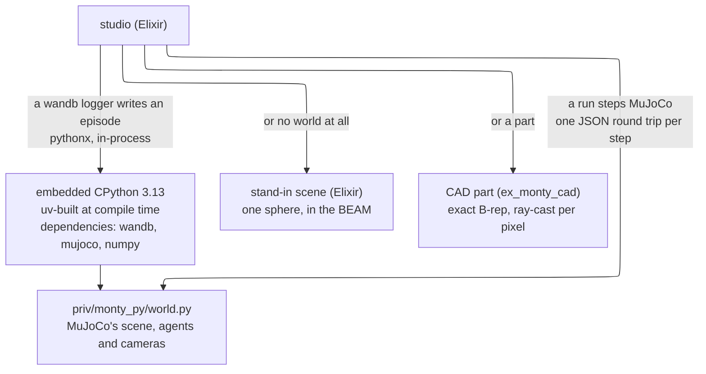
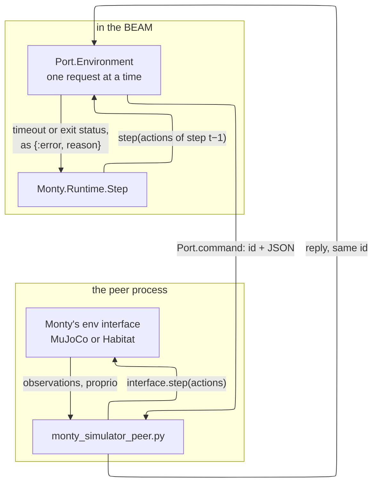
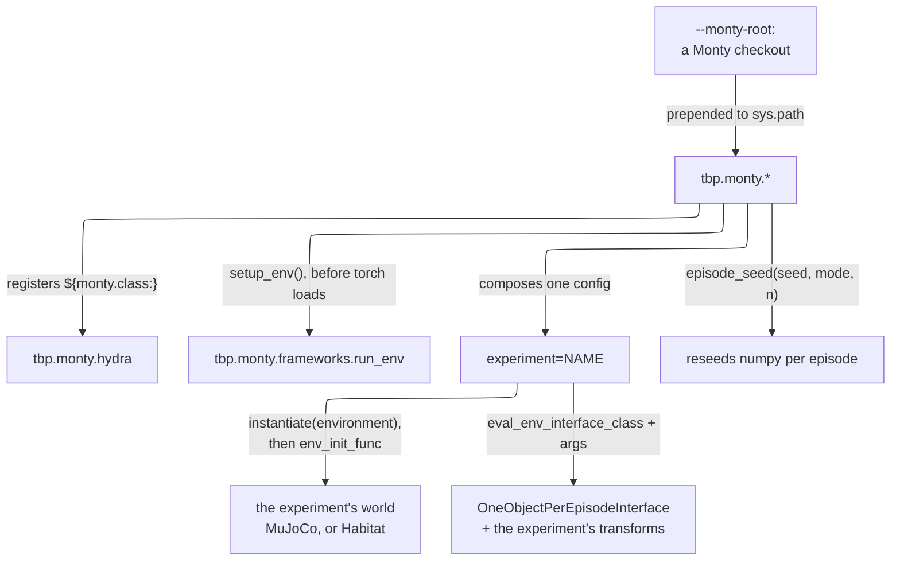
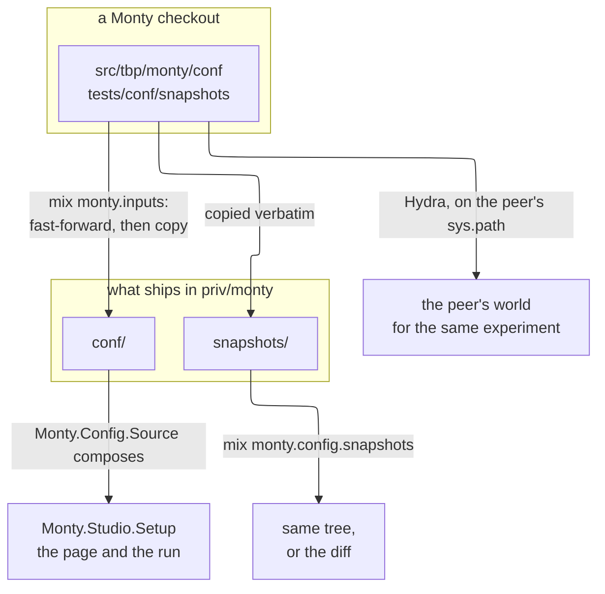
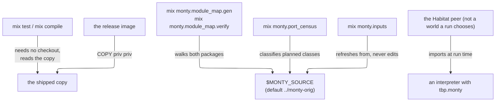
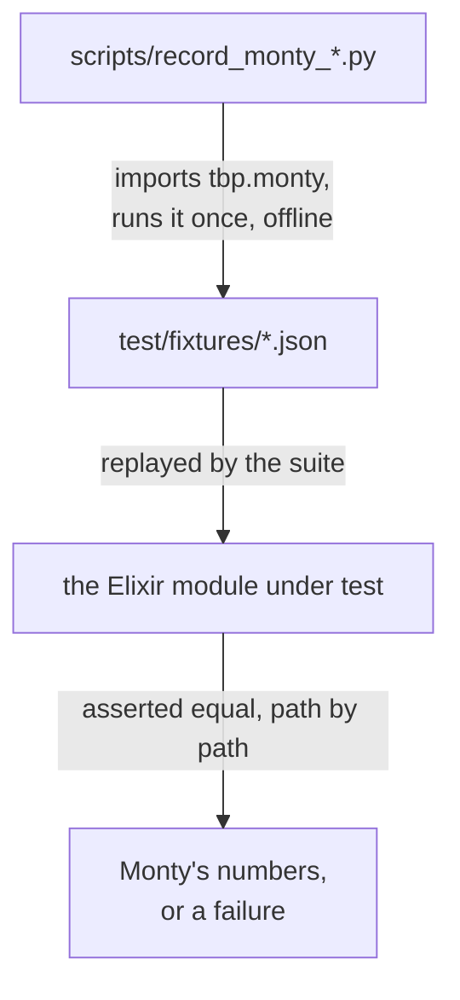

# Architecture

Monty's Python runtime is one loop over modules. Here, each module is a
process, but the _order_ and the _payloads_ stay Monty's, because that is what
makes results comparable.

## A timestep

The coordinator (`Monty.Runtime.Step`) runs Monty's `Monty._matching_step` as a
sequence of barriers. Every phase is a fan-out and a gather (`Monty.Runtime.Barrier`),
so a module can be inspected, restarted or replaced without touching the
coordinator.

Facts worth keeping in mind, all inherited from Monty:

- the action produced at step _t_ is executed by the environment at the start of
  step _t+1_;
- a learning module receives another learning module's `get_output` from the
  _previous_ step, and only if at least one sensor percept passed that step;
- a location-only step (no percept with `process_features_in_lm`) displaces
  hypotheses without updating evidence;
- sensor modules are stepped **one at a time**, not as a barrier: a sensor may
  draw from the episode's random stream (the salience module dithers its
  scores), and a barrier would let the scheduler decide which drew first.
  `Monty.Random.Stream`'s moduledoc says so at the code site.

## Why processes

A model (`Monty.Runtime.Model`) is a supervisor: one child per sensor module,
one per learning module, and the step coordinator last. The strategy is
`:one_for_one` and modules are addressed by registered name
(`{:learning_module, model_id, id}`), so a module that dies is replaced without
the coordinator losing its step count.

- **Isolation.** A module that dies is replaced by the model's supervisor, and the
  coordinator addresses it again by name. A module that is unavailable or late is
  reported in that step's info (`sensor_timeouts`, the vote round's `timed_out`)
  rather than taking the step with it. The Python runtime cannot offer that.
- **Voting as messaging.** The round is `Monty.Runtime.Barrier`: one
  `Task.async_stream` pass over the modules, `ordered: true` so the gather is
  the listing order and not the arrival order, `on_timeout: :kill_task` so a
  late module costs only its own reply. `:infinity` reproduces Python's
  synchronous round exactly; a finite deadline is the experiment from
  [the neural-voting thread](https://forum.thousandbrains.org/t/software-architecture-for-neural-voting/129):
  the round closes when time is up, and the step reports what it used
  (`votes_used`) and that it was short (`deadline_hit?`).
- **No GIL.** Columns are independent; the scheduler already interleaves them.

## Determinism

Python threads one mutable `RandomState` (`ctx.rng`) through every module, so
what a module draws depends on how many draws the modules before it made. That
object is shared and mutable, which is why it is a process here:
`Monty.Random.Stream` is one child per model, holding a `Monty.Random.Numpy`
state, reseeded when the episode's seed changes. A module draws through
`Monty.Context.rng` in the order it is stepped — Monty's order — so a seeded
episode produces NumPy's numbers, in the same sequence.

`Monty.Context.rng_for/2` is the older arrangement, still used where a site has
not moved onto the stream: the environment's noise transforms and a camera's
message noise, which draw per module per step. It derives a stream from the seed,
`phash2(module_id)` and the step, so it is independent of what ran before it —
and therefore a _different set of numbers_ by construction. §2.1 of
[`monty-differences.md`](monty-differences.md) lists what is left, which is what a diff of two
action logs eventually comes down to.

Determinism is a feature, not a coincidence: the coordinator advances the step,
never a module, and nothing in a step reads the wall clock.

## The functional core

Every mapped module under [`lib/monty/`](../lib/monty) is a function of its
inputs: plain data in, plain data out, no processes and no side effects of its
own. The two
standing exceptions are named rather than hidden — a draw from the episode's
stream (`Monty.Context.rng`, a call to a process) and a world
(`Monty.Simulators.Mujoco.Environment` holds the interpreter it steps in, and
`Monty.Simulators.Habitat.Environment.HabitatEnvironment` would hold a port). The
actor layer is thin by design — routing, state holding, telemetry — and is the
only place that knows about GenServers. This is what lets a contributor port a
Python class and test it directly against Monty numbers, and what keeps the port
reviewable by Monty's team.

## Boundaries

| Boundary                                     | Payload                                                                          |
| -------------------------------------------- | -------------------------------------------------------------------------------- |
| environment → Monty                          | `(observations, proprioceptive_state)`                                           |
| sensor module → learning module              | `Monty.Cmp.Message` (location, pose vectors, features, `process_features_in_lm`) |
| learning module → learning module (top-down) | `Message` with `sender_type: :lm`                                                |
| learning module ↔ learning module (vote)     | per-object pose hypotheses plus the sender's `sensed_pose_rel_body`              |
| learning module → motor system               | `Monty.Cmp.Goal`                                                                 |
| motor system → environment                   | a list of `Monty.Frameworks.Actions` structs                                     |

Units and conventions are Monty's: metres, degrees in actions, quaternions
scalar-first (`wxyz`), semantic id `0` for background, sensor poses relative to
the agent, agent poses absolute.

The body is read out of the experiment's own `motor_system_config`: the
`_target_` of the motor system, of the policy selector and of every policy
resolves through the module map, and each class's `from_config/1` reads the
parameters it knows (`Monty.Config.Target`). A class the port has not written is
an error, never a stand-in, so a run built from a config is a run of that config.

The environment boundary for a world outside this release is a port:
`Monty.Simulators.Port.Protocol` is the contract and
`Monty.Simulators.Port.Environment` owns the process, so such a world could be
Habitat or a camera without touching the model. The world a run steps today is
not one of those: MuJoCo runs in the interpreter this application carries, behind
the same `Monty.Simulators.Environment` behaviour. See
[`simulator-port.md`](simulator-port.md).

## What comes from Monty

Four things are _copied_, the module contract and the census are _generated_, and
the world is written here. The distinction is the one to keep: a copy can be
diffed against a checkout, a generated file is a map _of_ Monty rather than a
copy of it, and the world is a re-implementation against the same library Monty
uses — and only the last of the three is code this repository owns.

| Kind         | What                                                                                   | Handles it                                                                             |
| ------------ | -------------------------------------------------------------------------------------- | -------------------------------------------------------------------------------------- |
| copied       | Monty's config tree, the snapshots it was composed into, and its licence               | `mix monty.inputs`                                                                     |
| derived      | Monty's pretrained memories, exported to a format this port reads                      | the prerequisite fetch (`/prerequisites`, `mix monty.prerequisites.fetch`)             |
| generated    | the module contract (`lib/monty/module_map/data.ex`) and the two census files          | `mix monty.module_map.gen`, `mix monty.port_census`, `mix monty.target_census`         |
| written here | the world — MuJoCo's scene, agents and cameras, mirroring Monty's `simulators/mujoco/` | [`priv/monty_py/world.py`](../priv/monty_py/world.py), run by the embedded interpreter |

Every path, glob, writer and the command that checks it is in
[`from-monty.md`](from-monty.md) — one list, kept there so it cannot drift from
one page to another. What deliberately does not travel, and why, is in the same
place.

## Where Python is

One interpreter, and it is this application's own: built into the release by uv
at compile time, reached through `pythonx` ([`config/pythonx.exs`](../config/pythonx.exs)).
Two things use it, and neither is optional:

- the **world** — `priv/monty_py/world.py`, MuJoCo driven the way Monty drives
  it, answering observations and proprioceptive state;
- the **wandb logger** — `Monty.Frameworks.Loggers.WandbHandlers.PythonxClient`.

There is no second interpreter and nothing to configure: an operator does not
install a Python, and `MONTY_PYTHON` is not what a run looks at. The third
choice a run has is the stand-in scene, which is Elixir and needs no interpreter
at all.

A fourth is a **CAD part** (`--world cad`, `MONTY_CAD_PART=part.step`): the same
world as the stand-in — its kinematics, actions and proprioceptive state — with
`MontyCad.Scene` rendering the picture by ray-casting the exact B-rep. That
module is `ex_monty_cad`'s, which a studio node need not carry, so it is asked
for by name and a node without it refuses the world with a sentence. It is not a
world Monty's own configs were written for: every page says so, because a number
it reports is not the experiment's.

That the interpreter is a real dependency rather than a decoration is reported at
run time by `ExTbpMonty.EmbeddedPython.version/0`, so a page cannot say
"prerequisites present" while a MuJoCo run would fail.

### One step across the port

The peer is [`scripts/monty_simulator_peer.py`](../scripts/monty_simulator_peer.py). `Monty.Simulators.Habitat.Environment.HabitatEnvironment`
is the handle that would own it — `new/1` starts nothing, because a run may never
step — and the first step starts the peer as an OS process (`Port.open` with
`{:packet, 4}`). It speaks length-prefixed JSON and knows nothing about Elixir
except the framing. No run holds that handle: a config naming Habitat is refused
as a world this build does not carry, and which world a run stepped is recorded
on the run.

The action produced at step _t_ reaches the world at step _t+1_ because the
experiment, not the port, decides when to step: the port only carries them. A
`reset` is answered with more than `ok`: the peer reports `primary_target` (which
object the episode is about — its interface sampled it, so nothing else knows)
and `semantic_id_to_label` (what a semantic image's id means). Without the first
the model would be scoring itself against nothing; without the second a run could
not name what it recognised.

### What the peer imports from a Monty checkout

`--monty-root` names a checkout and is put on `sys.path` as `<root>/src`. Only an
operator sets it: `:monty_peer` says so explicitly, and nothing guesses a
neighbouring checkout at run time — the peer imports the Monty its own
interpreter carries, which is what the image ships. A path named here is made
absolute, because a relative one quietly picks another checkout.
Everything below is Monty's own code, imported from that checkout.

The peer drives the episode cycle itself — `pre_epoch/0` once, `post_episode/0`
per episode, then the interface's positioning procedure — because that is what
Monty's epoch loop does and the first observation a model sees depends on it.
The model is not there: it is here, in Elixir.

### The YAML has two readers

Monty's config tree is read by Hydra (in the peer) and by `Monty.Config.Source`
(in the BEAM). They read different copies of the same files: the peer composes
`tbp.monty.conf` out of the checkout on its `sys.path`, and the BEAM composes
[`priv/monty/conf`](../priv/monty/conf), which is a verbatim copy taken from a
checkout.

The copy is what makes a build, a test run and a CI job need no checkout at
all. Nothing compares the copy to the peer's checkout at run time; the check is
`mix monty.config.snapshots`, and it runs against the copy or, with `--source`,
against a checkout.

### What needs a checkout, and what only needs the copy

`MONTY_SOURCE` and `TELEOP_SOURCE` point at checkouts for the tasks that
regenerate or verify. The suite is run with both pointing at `/nonexistent` to
prove it.

### Fixtures: Monty's answer, recorded once

Parity is asserted against recordings rather than against a live Monty. Each
recording script runs Monty in Monty's environment, writes what it answered, and
the suite replays that JSON through this port.

A recording is a fact about the commit it was taken from, which is why
`mix monty.module_map.verify` reports a checkout that has moved since.

## Observability

A run is a row, not a buffer: `Monty.Studio.RunHistory` writes every step to
`studio_runs` as it happens, and `Monty.Studio.Jobs.Run` broadcasts on
`studio:run:<id>` over `Phoenix.PubSub`, which is what a LiveView subscribes to
and streams. The log file the run writes (`run.log`, next to Monty's artifacts)
is the same text the page shows.

Vote rounds and steps are measured from the step coordinator: `Monty.Runtime.Step`
emits one event, `[:monty, :step, :stop]`, with `duration` (microseconds) as the
measurement and `step`, `votes_used`, `deadline_hit?` as metadata
([`lib/monty/runtime/step.ex`](../lib/monty/runtime/step.ex)). That is what a
latency experiment reads: a round that closed early says so, and how many votes
it actually used is beside it.

### What the console says

Four things reach it, and each has one level:

| what                                                                                         | level         |
| -------------------------------------------------------------------------------------------- | ------------- |
| a run starting, finishing or failing; a page opened; a connection opened and closed          | `:info`       |
| a write that could not happen, a run that had to be abandoned                                | `:warning`    |
| a run that could not start at all                                                            | `:error`      |
| the experiment talking to itself — what Monty's `logger.info` prints per step and per module | `Monty.Trace` |

That last one is not a level `Logger` has, because it is not one it should: a run
of twenty thousand steps says "did not recognize an object yet" twenty thousand
times, and a console reading that is a console nobody can read
([`lib/monty/trace.ex`](../packages/ex_tbp_monty_core/lib/monty/trace.ex)). It is
below `:debug`, off by default, and on with `MONTY_TRACE=1` (or
`config :ex_tbp_monty_core, experiment_trace: true`), where it arrives at
`:debug`. Development shows `:debug`; a release stops at `:info`.

Two things that would be noise are therefore quiet by their own rules rather
than by the level: Ecto does not log statements (`log: false` on both repos — a
page following a run reads the database on a timer), and Phoenix LiveView does
not log every mount and event (`use Phoenix.LiveView, log: false` in
`ExTbpMontyWeb.live_view/0`). A page being debugged puts `log: :debug` back on
its own module.
