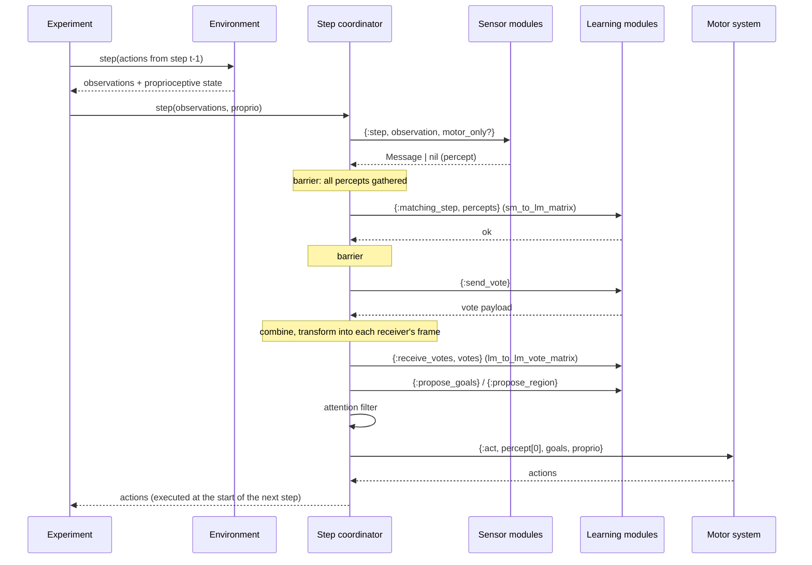

# Architecture

Monty's Python runtime is one loop over modules. Here, each module is a
process, but the *order* and the *payloads* stay Monty's, because that is what
makes results comparable.

## A timestep

The coordinator (`Monty.Runtime.Step`, next phase) runs Monty's
`Monty._matching_step` as a sequence of barriers. Every phase is a fan-out and
a gather, so a module can be inspected, restarted or replaced without touching
the coordinator.

Facts worth keeping in mind, all inherited from Monty:

* the action produced at step *t* is executed by the environment at the start of
  step *t+1*;
* a learning module receives another learning module's `get_output` from the
  *previous* step, and only if at least one sensor percept passed that step;
* a location-only step (no percept with `process_features_in_lm`) displaces
  hypotheses without updating evidence.

## Why processes

* **Isolation.** A learning module that crashes is restarted; the run continues
  and is marked degraded. The Python runtime cannot offer that.
* **Voting as messaging.** `:gen_server.multi_call` gathers votes with a
  timeout. `:infinity` reproduces Python's synchronous round exactly; a finite
  deadline is the experiment from
  [the neural-voting thread](https://forum.thousandbrains.org/t/software-architecture-for-neural-voting/129):
  the round closes when time is up and reports how many votes it used.
* **No GIL.** Columns are independent; the scheduler already interleaves them.

## Determinism

Python threads one mutable `RandomState` through every module. Here the
coordinator owns an immutable RNG value and passes it through the same call
order, so a seeded episode is reproducible. A `:per_module` stream mode is
planned for parallel steps; it will be a mode, not the default.

## The functional core

Every mapped module under `lib/monty/` is pure: data in, data out, no
processes, no side effects. The actor layer is thin by design — routing,
state holding, telemetry — and is the only place that knows about GenServers.
This is what lets a contributor port a Python class and test it directly
against Monty numbers, and what keeps the port reviewable by Monty's team.

## Boundaries

| Boundary | Payload |
| --- | --- |
| environment → Monty | `(observations, proprioceptive_state)` |
| sensor module → learning module | `Monty.Cmp.Message` (location, pose vectors, features, `process_features_in_lm`) |
| learning module → learning module (top-down) | `Message` with `sender_type: :lm` |
| learning module ↔ learning module (vote) | per-object pose hypotheses plus the sender's `sensed_pose_rel_body` |
| learning module → motor system | `Monty.Cmp.Goal` |
| motor system → environment | a list of actions (Monty's `ActionJSONEncoder` shape) |

Units and conventions are Monty's: metres, degrees in actions, quaternions
scalar-first (`wxyz`), semantic id `0` for background, sensor poses relative to
the agent, agent poses absolute.

## Observability

`Monty.Runs.Log` keeps a bounded ring buffer in ETS and broadcasts on
`run:<id>`; LiveViews subscribe and render with `stream/3`. Vote rounds emit
`:telemetry` events with `sent`, `received`, `inputs_used`, `deadline_hit?` and
duration, which is what the latency experiments need.
