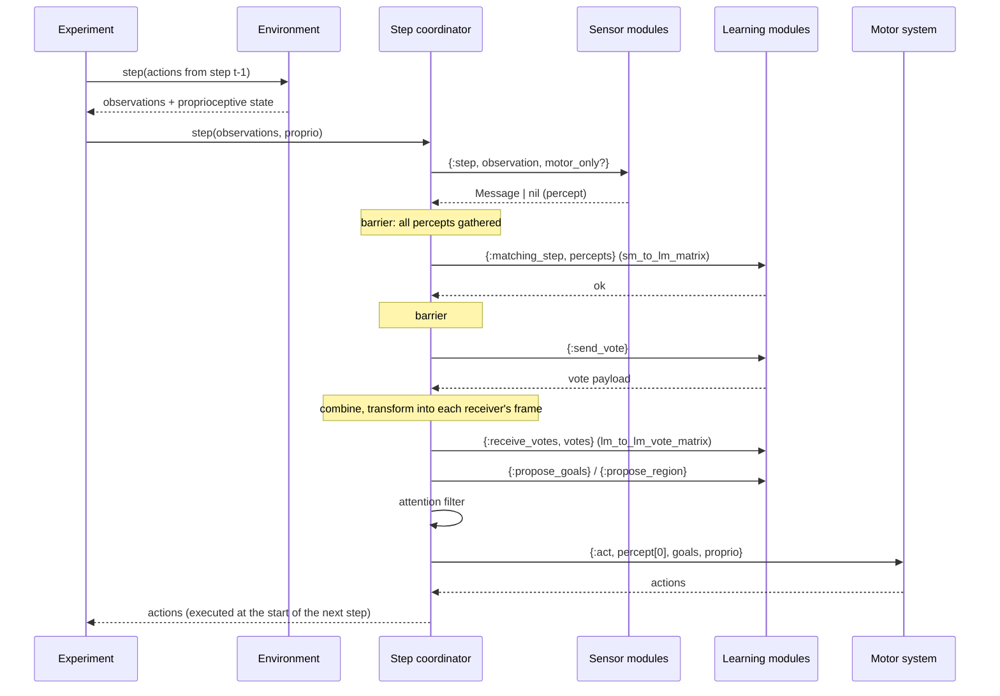
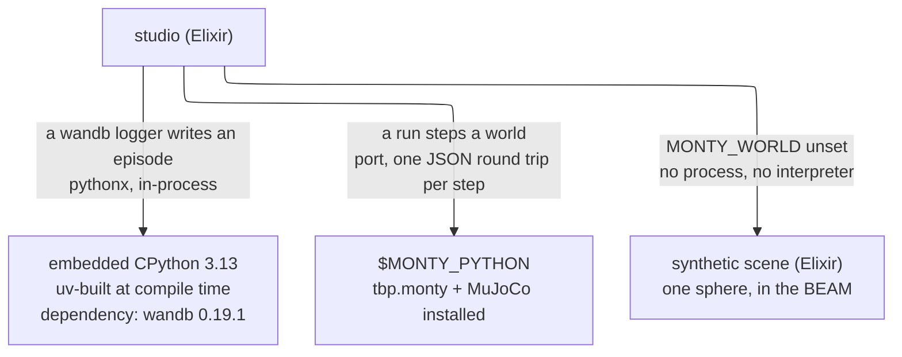
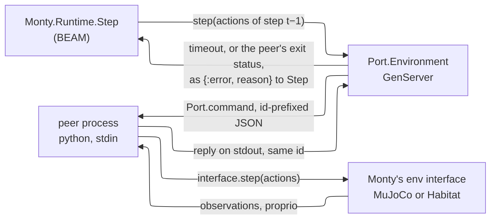
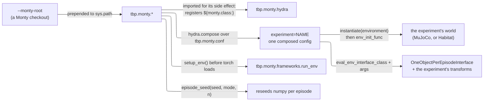
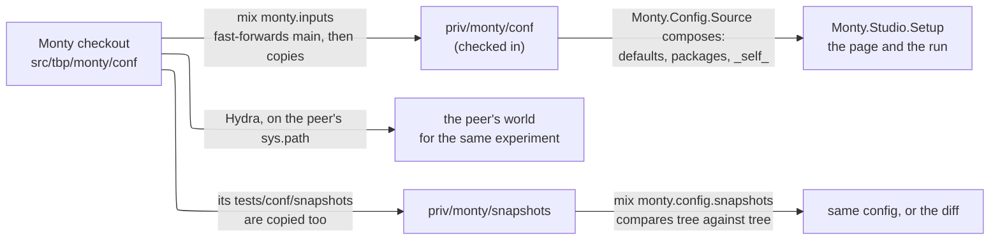
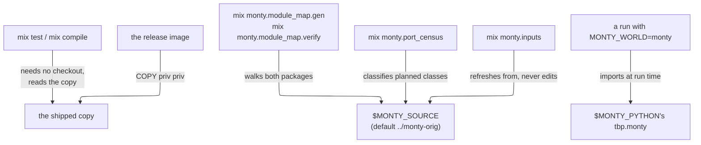
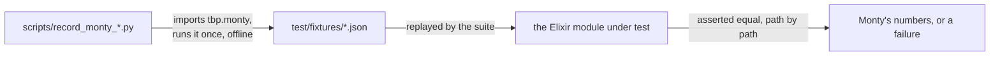

# Architecture

Monty's Python runtime is one loop over modules. Here, each module is a
process, but the *order* and the *payloads* stay Monty's, because that is what
makes results comparable.

## A timestep

The coordinator (`Monty.Runtime.Step`) runs Monty's `Monty._matching_step` as a
sequence of barriers. Every phase is a fan-out and a gather (`Monty.Runtime.Barrier`),
so a module can be inspected, restarted or replaced without touching the
coordinator.

Facts worth keeping in mind, all inherited from Monty:

* the action produced at step *t* is executed by the environment at the start of
  step *t+1*;
* a learning module receives another learning module's `get_output` from the
  *previous* step, and only if at least one sensor percept passed that step;
* a location-only step (no percept with `process_features_in_lm`) displaces
  hypotheses without updating evidence.

## Why processes

A model (`Monty.Runtime.Model`) is a supervisor: one child per sensor module,
one per learning module, and the step coordinator last. The strategy is
`:one_for_one` and modules are addressed by registered name
(`{:learning_module, model_id, id}`), so a module that dies is replaced without
the coordinator losing its step count.

* **Isolation.** A learning module that crashes is restarted; the run continues
  and is marked degraded. The Python runtime cannot offer that.
* **Voting as messaging.** `:gen_server.multi_call` gathers votes with a
  timeout. `:infinity` reproduces Python's synchronous round exactly; a finite
  deadline is the experiment from
  [the neural-voting thread](https://forum.thousandbrains.org/t/software-architecture-for-neural-voting/129):
  the round closes when time is up and reports how many votes it used.
* **No GIL.** Columns are independent; the scheduler already interleaves them.

## Determinism

Python threads one mutable `RandomState` through every module. Here the
coordinator owns an immutable RNG value and passes it through the same call
order, so a seeded episode is reproducible. A `:per_module` stream mode is
planned for parallel steps; it will be a mode, not the default.

## The functional core

Every mapped module under `lib/monty/` is pure: data in, data out, no
processes, no side effects. The actor layer is thin by design — routing,
state holding, telemetry — and is the only place that knows about GenServers.
This is what lets a contributor port a Python class and test it directly
against Monty numbers, and what keeps the port reviewable by Monty's team.

## Boundaries

| Boundary | Payload |
| --- | --- |
| environment → Monty | `(observations, proprioceptive_state)` |
| sensor module → learning module | `Monty.Cmp.Message` (location, pose vectors, features, `process_features_in_lm`) |
| learning module → learning module (top-down) | `Message` with `sender_type: :lm` |
| learning module ↔ learning module (vote) | per-object pose hypotheses plus the sender's `sensed_pose_rel_body` |
| learning module → motor system | `Monty.Cmp.Goal` |
| motor system → environment | a list of `Monty.Frameworks.Actions` structs |

Units and conventions are Monty's: metres, degrees in actions, quaternions
scalar-first (`wxyz`), semantic id `0` for background, sensor poses relative to
the agent, agent poses absolute.

The body is read out of the experiment's own `motor_system_config`: the
`_target_` of the motor system, of the policy selector and of every policy
resolves through the module map, and each class's `from_config/1` reads the
parameters it knows (`Monty.Config.Target`). A class the port has not written is
an error, never a stand-in, so a run built from a config is a run of that config.

The environment boundary is a port: `Monty.Simulators.Port.Protocol` is the
contract and `Monty.Simulators.Port.Environment` owns the process, so the world
can be MuJoCo, Habitat or a camera without touching the model. See
[`simulator-port.md`](simulator-port.md).

## Where Python is, and is not

Two interpreters are involved and they never meet. One is carried by the
application, built into the release by uv, and reached only by the ported wandb
logger (`config/pythonx.exs`, `Monty.Frameworks.Loggers.WandbHandlers.PythonxClient`).
The other is *yours*: `MONTY_PYTHON` (or `python3` on the PATH if it is unset), an
interpreter with Monty installed, which runs the world on the other side of the
port. A run with `MONTY_WORLD` unset steps neither of those worlds — the stand-in
scene is Elixir — although a config that names a wandb logger reaches the
embedded interpreter whatever the world is.

That the embedded interpreter is a real dependency rather than a decoration is
reported at run time by `ExTbpMonty.EmbeddedPython.version/0`, so a page cannot
say "prerequisites present" while a wandb run would fail.

### One step across the port

The peer is `scripts/monty_simulator_peer.py`. It is started as an OS process
(`Port.open` with `{:packet, 4}`) and speaks length-prefixed JSON; it knows
nothing about Elixir except the framing.

The action produced at step *t* reaches the world at step *t+1* because the
experiment, not the port, decides when to step: the port only carries them.

### What the peer imports from a Monty checkout

`--monty-root` (default `$MONTY_ROOT`, else whatever `tbp` is importable) is put
on `sys.path` as `<root>/src`. Everything below is Monty's own code, imported
from that checkout.

The peer drives the episode cycle itself — `pre_epoch/0` once, `post_episode/0`
per episode, then the interface's positioning procedure — because that is what
Monty's epoch loop does and the first observation a model sees depends on it.
The model is not there: it is here, in Elixir.

### The YAML has two readers

Monty's config tree is read by Hydra (in the peer) and by `Monty.Config.Source`
(in the BEAM). They read different copies of the same files: the peer composes
`tbp.monty.conf` out of the checkout on its `sys.path`, and the BEAM composes
`priv/monty/conf`, which is a verbatim copy taken from a checkout.

The copy is what makes a build, a test run and a CI job need no checkout at
all. Nothing compares the copy to the peer's checkout at run time; the check is
`mix monty.config.snapshots`, and it runs against the copy or, with `--source`,
against a checkout.

### What needs a checkout, and what only needs the copy

`MONTY_SOURCE` and `TELEOP_SOURCE` point at checkouts for the tasks that
regenerate or verify. The suite is run with both pointing at `/nonexistent` to
prove it.

### Fixtures: Monty's answer, recorded once

Parity is asserted against recordings rather than against a live Monty. Each
recording script runs Monty in Monty's environment, writes what it answered, and
the suite replays that JSON through this port.

A recording is a fact about the commit it was taken from, which is why
`mix monty.module_map.verify` reports a checkout that has moved since.

## Observability

A run is a row, not a buffer: `Monty.Studio.RunHistory` writes every step to
`studio_runs` as it happens, and `Monty.Studio.Jobs.Run` broadcasts on
`studio:run:<id>` over `Phoenix.PubSub`, which is what a LiveView subscribes to
and streams. The log file the run writes (`run.log`, next to Monty's artifacts)
is the same text the page shows.

Vote rounds emit `:telemetry` events from the step coordinator
(`lib/monty/runtime/step.ex`) with `sent`, `received`, `inputs_used`,
`deadline_hit?` and a duration, which is what the latency experiments need.
