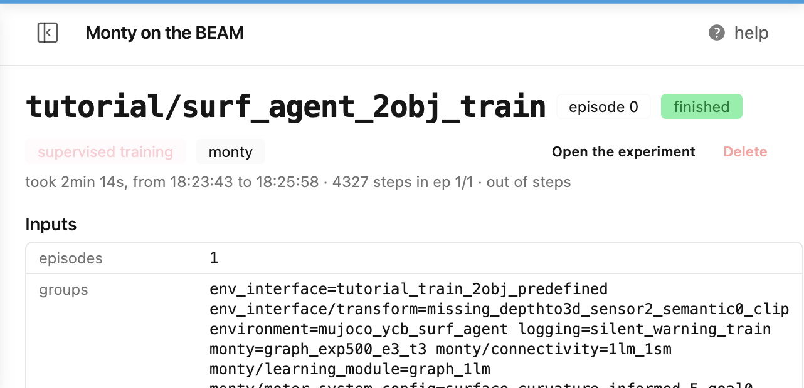
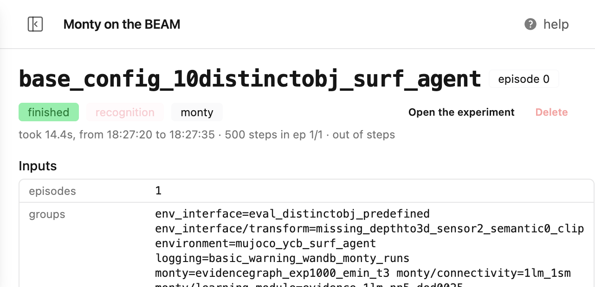
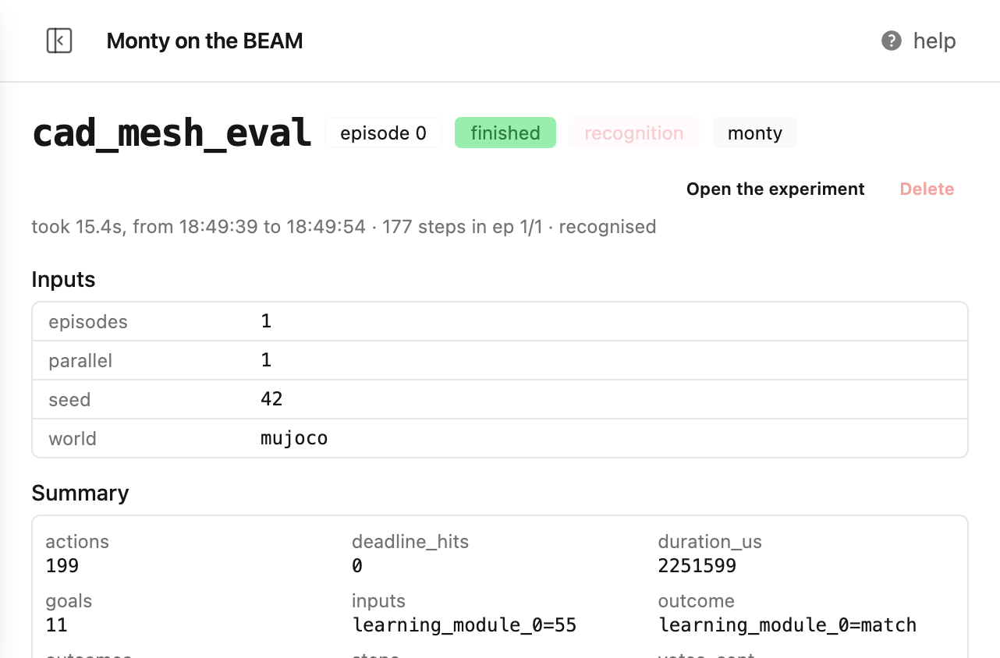

# First results: a part learned, and a part not

What was run, on this machine (macOS, one node, `MIX_ENV=dev`), and what the
pages said. Every number below is one run's, and each section names the command
that prints it again.

## The nine sets, as they stand

`priv/monty_experiments/sets/cad/README.md` is the set's own report — the sizes,
the memory behind each run, and why each number is what it is. Through the page's
`Run it`, world `ex_mujoco`, seed 42, the config's own episodes on this Mac:

| set                              | episodes | answer               |
| -------------------------------- | -------- | -------------------- |
| `cad/plate_pretrain`             | 1        | learned 20 nodes     |
| `cad/plate_learned_eval`         | 3        | 2 match, 1 no_match  |
| `cad/plate_part_eval`            | 3        | 3 match              |
| `cad/plate_pair_eval`            | 3        | 3 match              |
| `cad/parts_set_eval`             | 6        | 6 match              |
| `cad/blend_part_eval`            | 3        | 2 match, 1 no_match  |
| `cad/blend-big_part_eval`        | 3        | 3 match              |
| `cad/plate_features_eval`        | 12       | 8 match, 4 time_out  |
| `cad/plate_features_2patch_eval` | 12       | 11 match, 1 no_match |

A part is recognised in every epoch it is asked. The feature runs are the harder
question: what a patch reports cannot separate the plate's body from its risers,
so the four episodes asked about the bore end at the step cap with both still
possible.

The sections below are the first measurements, kept as they were taken: three
stages for one part, in the exact world and in a mesh world, with the control
that a memory of another part does not conclude.

## 1. Training, in the CAD world, on the geometry's own labels

```sh
MONTY_CAD_LABELS=features MONTY_CAD_PART=bracket mix run tmp/cad_run.exs \
  tutorial/surf_agent_2obj_train --world cad --episodes 1 --record
```

`MONTY_CAD_LABELS=features` is what makes the part more than one object: the
world's mask then carries `bosses/0`, `holes/0`, `risers/0` and `<part> body`
(`MontyCad.Scene`), instead of one id for the whole part.



- `tutorial/surf_agent_2obj_train`, `supervised training`, **finished**.
- 4327 steps in one episode, 2 min 14 s.
- "the memory now holds **1 object and 442 nodes**".
- "no episodes concluded" — correct: a _supervised pretraining_ episode stores a
  graph, it does not decide.

## 2. Recognition, with a memory of the part

```sh
mix run scripts/cad_experiment.exs plate plate
```

The script samples the part, writes the library a run loads and steps it. Its own
output first:

```
plate: 1557 nodes at 2.0 mm, 226 skipped, families %{nil => 892, "bosses" => 56,
  "holes" => 16, "risers" => 593}
```

— every node's family is the recognition's, read rather than inferred, and the 226
skipped visits are patches that saw too little surface to be a node.


`base_config_10distinctobj_surf_agent` on the `cad` world: **finished**,
`recognition`, **420 steps in ep 1/1 · recognised**, 13 s.


One object believed — `plate` — and its evidence climbed to **20.41** over 420
steps. That curve is the whole claim: the patch alone, moving over exact
geometry, accumulated enough to name the part it had a memory of.


What the sensor saw at the last recorded step: the patch (left) and the same
frame as recorded, with the wide `view_finder` beside it. The gradient is the CAD
world's _shading_ — a B-rep has no colour, so `rgba` says how the surface turns.
A run comparing features on a textured mesh must therefore not ask for `hsv`.

## 3. The control: a part the memory does not hold

```sh
CAD_SENSE_ONLY=1 mix run scripts/cad_experiment.exs plate blend
```

Same memory (of `plate`), sensing `blend` instead.



**500 steps in ep 1/1 · out of steps** — not recognised, and 14.4 s to say so. The
pair is the result: a memory of this part recognises it, and the same memory does
not conclude on a part it was never shown.

## 4. The same memory, in a mesh world

```sh
mix run scripts/cad_mesh_eval.exs
```

The part is written as an object set the MuJoCo world steps — `textured.obj`,
`texture_map.png`, `metadata.json`, in metres, at its own scale, under the name
the memory carries — and the run's world is then MuJoCo. Nothing on that path
asks quiddity anything: `ExTbpMonty.Cad.Objects` is the last thing that reads the
STEP file, and it runs before the episode starts.

```
object: plate — 460 faces, 468 vertices
memory: /tmp/cad-experiment/plate — reading plate
```



`cad_mesh_eval` — **finished**, `recognition`, world **mujoco**, 222 steps in
ep 1/1, **recognised**: `outcome learning_module_0=match`, 14.4 s, strongest
evidence **24.43**.


The memory written against the exact B-rep named `plate` from the mesh, in half
the steps it took against the B-rep itself (222 against 420) and against
_stronger_ evidence (24.43 against 20.41). It did not say that the first time.

### What the first run was really measuring

The first pass at this reached evidence 8.43 and had a shape worth reading: up to
8.0, a long flat stretch, then six steps that each cost exactly one — 8.0 down to
2.0 — and then a climb. Those six are not the features: a node's feature evidence
is the weighted average of how far inside its tolerance each column sits — `1` at
a perfect match, `0` at the tolerance — and pose evidence lives in `[-1, 1]`, with
a hypothesis whose predicted place holds no learned node within
`max_match_distance` taking the floor of exactly `-1`. A step of exactly minus
one is that floor: the model predicted somewhere it has nothing stored. What the
colour changed is the other kind of step, the healthy ones, which moved from
`+0.95` to `+1.28` — the same geometry scoring higher on a feature that now
matches.

The cause was colour, and it was ours. The CAD world's `rgba` is _shading_: one
light, so the memory learned hue 0 with value 0.25, 0.62 and 0.83. `MontyCad.Export`
wrote `{0.72, 0.72, 0.75}` — blue a step above red, a hue of 0.583 — and the
tutorial's learning module matches `hsv` at tolerance 0.1 with hue weighted 2,
the loudest column it has. Every observation in the mesh world was therefore
scored zero on the feature that counts most, and no amount of lighting could
repair it: a light scales a colour, it does not paint it. `ExTbpMonty.Cad.Objects`
put the number in the texture; `MontyCad.Export` chose it.

The export now writes one grey whose three channels are equal, which is the hue
and saturation the exact world shows whatever light either world applies. Two
cases in `ex_monty_cad` hold it there. The episode then reached a far stronger
conclusion in fewer steps, which is what the two curves are: the same memory, the
same world, three times the evidence.

What is left of the gap is the part both renderers guess at differently — how
bright a facet is under their own lights, and how much curvature a patch sees at
the same point. That does not explain the dip at step 90 or the fifty steps at
12.15 before it, and no feature could: the first is the `-1` floor, the second is
the agent not reaching new surface, which is the motor policy.

## What these results are, and are not

- **They are the three stages, for one part.** A memory built from exact geometry
  recognises that part; the same memory does not conclude on a part it never saw;
  and the same memory recognises the part as a mesh in a world with no CAD on its
  path. Each is one episode, so they say _that_ it happens — a rate wants seeds,
  and `scripts/cad_experiment.exs` takes `CAD_SEED`.
- **They are not compositional.** The memory holds the part as one object. The
  feature-level alternative is wired — `MONTY_CAD_LABELS=features` gives the CAD
  world one object per feature record, and `MontyCad.Export` meshes them the same
  way — but the `_compositional` / `_monolithic` pair of configs has not been run.
- **The labels are the geometry's own.** Nothing here was annotated by hand, and a
  face the recognition could not explain is the _body_: on this fixture the boss's
  top annulus is one, so a sensor looking straight down carries the body's id
  there. That is the honest failure mode of the whole approach, and the test in
  `ex_monty_cad` asserts it rather than papering over it.
