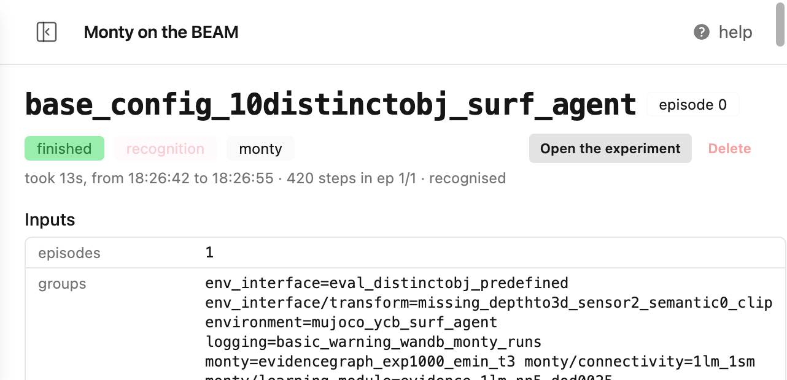
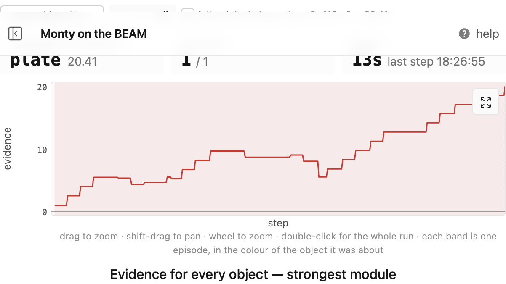
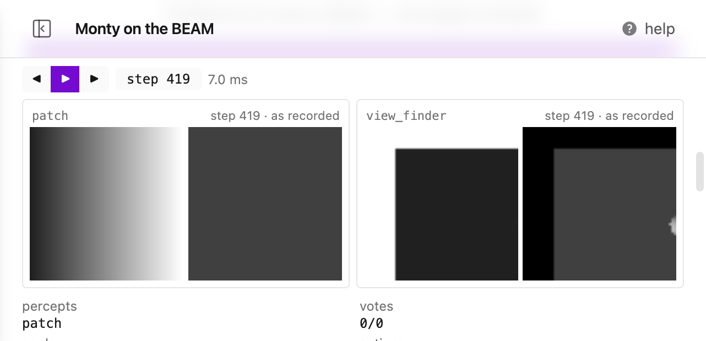
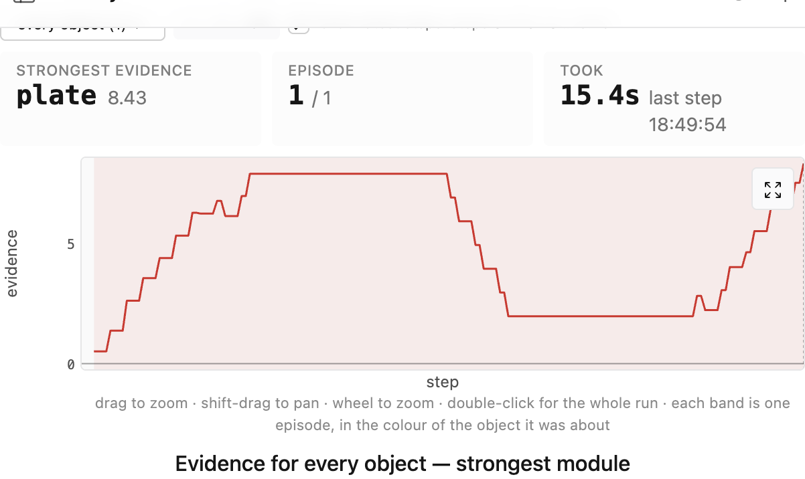

# First results: a part learned, and a part not

What was run, on this machine (macOS, one node, `MIX_ENV=dev`), and what the
pages said. Every number below is one run's, and each section names the command
that prints it again.

## 1. Training, in the CAD world, on the geometry's own labels

```sh
MONTY_CAD_LABELS=features MONTY_CAD_PART=bracket mix run tmp/cad_run.exs \
  tutorial/surf_agent_2obj_train --world cad --episodes 1 --record
```

`MONTY_CAD_LABELS=features` is what makes the part more than one object: the
world's mask then carries `bosses/0`, `holes/0`, `risers/0` and `<part> body`
(`MontyCad.Scene`), instead of one id for the whole part.


- `tutorial/surf_agent_2obj_train`, `supervised training`, **finished**.
- 4327 steps in one episode, 2 min 14 s.
- "the memory now holds **1 object and 442 nodes**".
- "no episodes concluded" — correct: a _supervised pretraining_ episode stores a
  graph, it does not decide.

## 2. Recognition, with a memory of the part

```sh
mix run scripts/cad_experiment.exs plate plate
```

The script samples the part, writes the library a run loads and steps it. Its own
output first:

```
plate: 1557 nodes at 2.0 mm, 226 skipped, families %{nil => 892, "bosses" => 56,
  "holes" => 16, "risers" => 593}
```

— every node's family is the recognition's, read rather than inferred, and the 226
skipped visits are patches that saw too little surface to be a node.



`base_config_10distinctobj_surf_agent` on the `cad` world: **finished**,
`recognition`, **420 steps in ep 1/1 · recognised**, 13 s.



One object believed — `plate` — and its evidence climbed to **20.41** over 420
steps. That curve is the whole claim: the patch alone, moving over exact
geometry, accumulated enough to name the part it had a memory of.



What the sensor saw at the last recorded step: the patch (left) and the same
frame as recorded, with the wide `view_finder` beside it. The gradient is the CAD
world's _shading_ — a B-rep has no colour, so `rgba` says how the surface turns.
A run comparing features on a textured mesh must therefore not ask for `hsv`.

## 3. The control: a part the memory does not hold

```sh
CAD_SENSE_ONLY=1 mix run scripts/cad_experiment.exs plate blend
```

Same memory (of `plate`), sensing `blend` instead.


**500 steps in ep 1/1 · out of steps** — not recognised, and 14.4 s to say so. The
pair is the result: a memory of this part recognises it, and the same memory does
not conclude on a part it was never shown.

## 4. The same memory, in a mesh world

```sh
mix run scripts/cad_mesh_eval.exs
```

The part is written as an object set the MuJoCo world steps — `textured.obj`,
`texture_map.png`, `metadata.json`, in metres, at its own scale, under the name
the memory carries — and the run's world is then MuJoCo. Nothing on that path
asks quiddity anything: `ExTbpMonty.Cad.Objects` is the last thing that reads the
STEP file, and it runs before the episode starts.

```
object: plate — 460 faces, 468 vertices
memory: /tmp/cad-experiment/plate — reading plate
```


`cad_mesh_eval` — **finished**, `recognition`, world **mujoco**, 177 steps in
ep 1/1, **recognised**: `outcome learning_module_0=match`, 15.4 s.



The memory written against the exact B-rep named `plate` from the mesh, in fewer
steps than it took against the B-rep itself (177 against 420). A tessellation of
the same surface is the same object to a graph, and a mesh world costs less per
step than a ray cast.

## What these results are, and are not

- **They are the three stages, for one part.** A memory built from exact geometry
  recognises that part; the same memory does not conclude on a part it never saw;
  and the same memory recognises the part as a mesh in a world with no CAD on its
  path. Each is one episode, so they say _that_ it happens — a rate wants seeds,
  and `scripts/cad_experiment.exs` takes `CAD_SEED`.
- **They are not compositional.** The memory holds the part as one object. The
  feature-level alternative is wired — `MONTY_CAD_LABELS=features` gives the CAD
  world one object per feature record, and `MontyCad.Export` meshes them the same
  way — but the `_compositional` / `_monolithic` pair of configs has not been run.
- **The labels are the geometry's own.** Nothing here was annotated by hand, and a
  face the recognition could not explain is the _body_: on this fixture the boss's
  top annulus is one, so a sensor looking straight down carries the body's id
  there. That is the honest failure mode of the whole approach, and the test in
  `ex_monty_cad` asserts it rather than papering over it.
