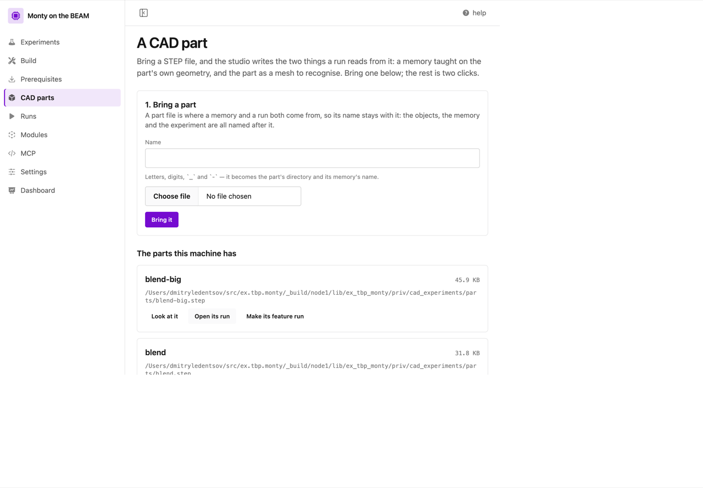
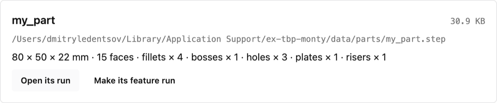
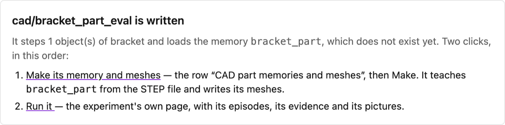
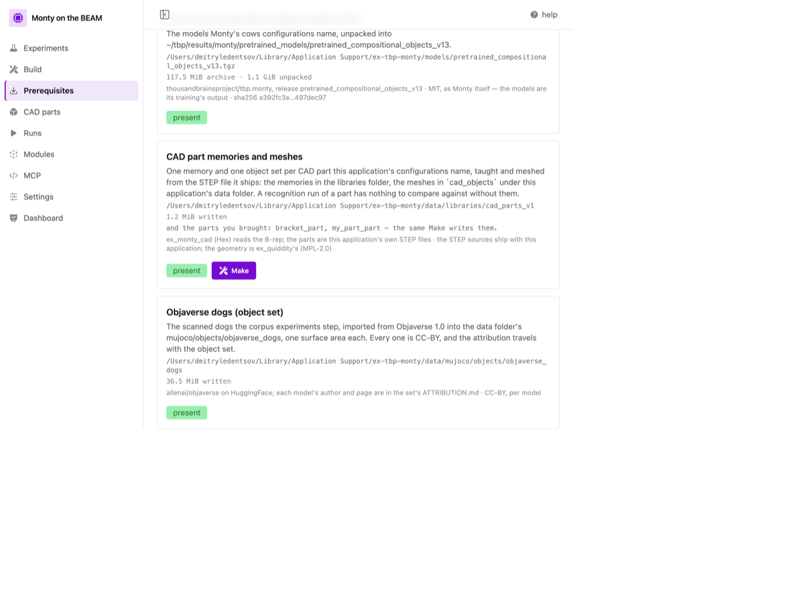
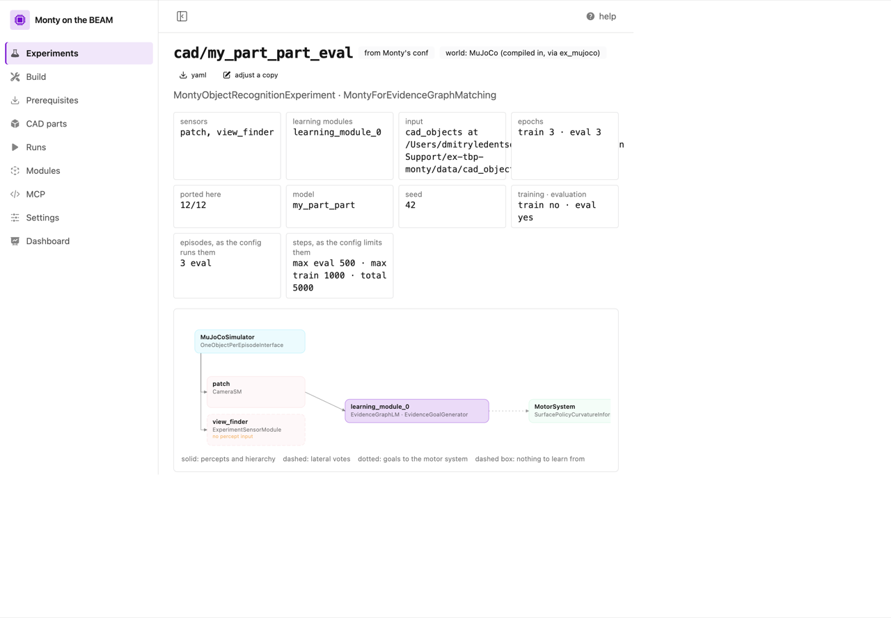
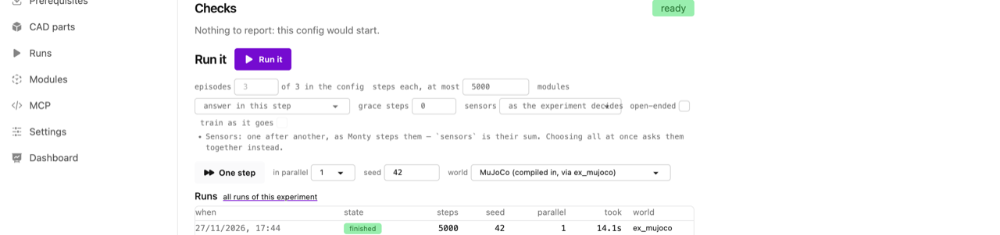
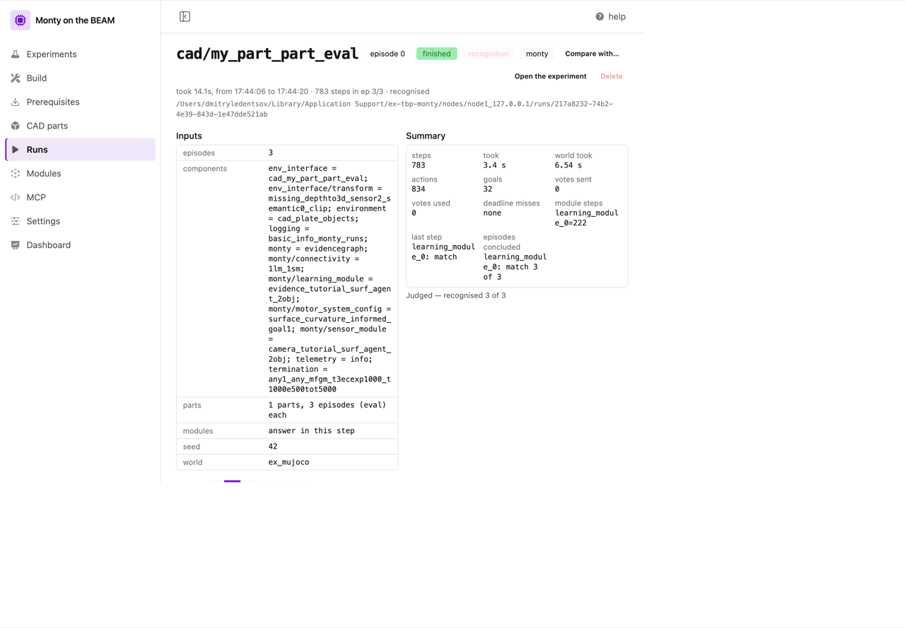
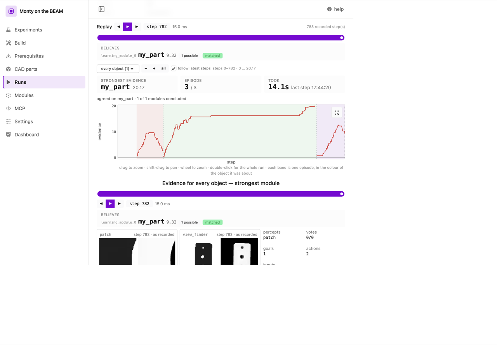

# A CAD part, click by click

The three clicks of [the CAD page](../../cad.md) are the whole of it: a STEP
file becomes a memory, the memory becomes something to recognise, and the run
says whether it did. This page is those clicks with what each one looks like,
taken on one machine — macOS, the studio on `localhost:4001`, one 80 × 50 ×
22 mm plate brought as `my_part.step`.

## 1. Bring a part

`/cad` takes a name and a file. The name stays with the part: it becomes the
part's directory, its objects, its memory and its experiment.

The card is quiddity's reading of the file, not ours — 80 × 50 × 22 mm, 15
faces, and the features the recognition found: four fillets, one boss, three
holes, a plate, a riser. A part whose run exists shows the link instead of the
button, which is why this card has "Open its run" and no "Make it a run".

## 2. Two clicks, in order

"Make it a run" writes `cad/<part>_part_eval` and the interface that names its
one object, and says what is left: the memory does not exist yet, the Make on
`/prerequisites` writes it, and then the experiment's own page runs it. The
card above is `bracket`, another of this machine's parts: a card offers the
click only while its run does not exist, so `my_part`'s already shows the link,
and every part's first generate says these two sentences.

## 3. The row that teaches it

One row covers every CAD part this machine has an experiment for — the shipped
ones and the ones a person brought (`bracket_part, my_part_part` above) — and
its Make teaches each from its own STEP file into
`$MONTY_DATA/libraries/cad_parts_v1/`, then meshes it into `$MONTY_DATA/cad_objects/`.
The row says "present" because the folder holds other parts' memories; the
sentence beside it is what says your part's is still missing, and the Make is
offered for that.

A second click teaches only what changed: each memory keeps a note of the part
file's bytes, the optics and the sampling it was written from, so
`my_part_part.taught.json` beside `my_part_part.jsonl.gz` is what makes the
second click cost a walk of the notes instead of the geometry.

## 4. The experiment it wrote

Everything on this page comes from the config the click wrote: one object
(`my_part`), the run's own two sensors, one evidence learning module, the
surface policy, three evaluation episodes, seed 42 — and `model:
my_part_part`, the memory the Make wrote. 12 of 12 classes the config names
run here.

## 5. Checks, then Run it

"ready" is not a promise about the run; it is the one thing a run cannot do
without, asked before it starts: the memory and the objects are there. Run it
steps the config as it stands.

## 6. The run

Three episodes, 783 steps, 14.1 s of wall clock, `ep 3/3 · recognised`: the
module concluded `match` in all three, and the strongest evidence it reached
for `my_part` was 20.17.

Each band of the chart is one episode, in the colour of the object it was
about. Below it, the patch's and the view finder's pictures at the step the
slider is on — the same two the memory was taught through, which is why the
two see one surface and not two.

## Where it landed

| What                           | Where                                                                                   |
| ------------------------------ | --------------------------------------------------------------------------------------- |
| the part file                  | `$MONTY_DATA/parts/my_part.step`                                                        |
| the experiment                 | `$MONTY_DATA/sets/brought/conf/experiment/cad/my_part_part_eval.yaml`                   |
| the interface naming its part  | `$MONTY_DATA/sets/brought/conf/env_interface/cad_my_part_part_eval.yaml`                |
| the memory and its note        | `$MONTY_DATA/libraries/cad_parts_v1/my_part_part.jsonl.gz` and `…taught.json` beside it |
| the part as MuJoCo objects     | `$MONTY_DATA/cad_objects/my_part/`                                                      |
| the run's log, steps, pictures | the node's folder, `…/nodes/<node>/runs/<run id>/`                                      |

The set under `sets/brought` is an ordinary experiment root, so `/experiments`
lists it, the builder offers it and a shell opens it by name
(`mix monty.run cad/my_part_part_eval`) with no other wiring. It is written
under the data folder and never into the source tree.

## The other arm, and the harder question

Every part offers two clicks. **Make it a run** is the part as one object — the
arm above, whose answer is known. **Make its feature run** writes
`cad/<part>_features_eval`: the same part as the features the recognition
found, one object per feature plus the stock between them. That is the arm the
compositional question needs, and it is where the wall is: two features report
the same surface with the same numbers, so their episodes end without a
verdict. [The CAD page](../../cad.md) records it, and what is worth doing about
it.

## What this page leaves out

- The first run on a fresh machine: the same `/prerequisites` page fetches what
  the world and the models need, and the rows say what each bundle costs before
  the click.
- The shipped experiments and their numbers — [the three stages](../../cad.md)
  and [the first results](../../cad-results.md).
- Teaching a part without a page in front of you: [the CAD page](../../cad.md)
  has the `mix run scripts/cad_experiment.exs` form, which is the same pipeline.
