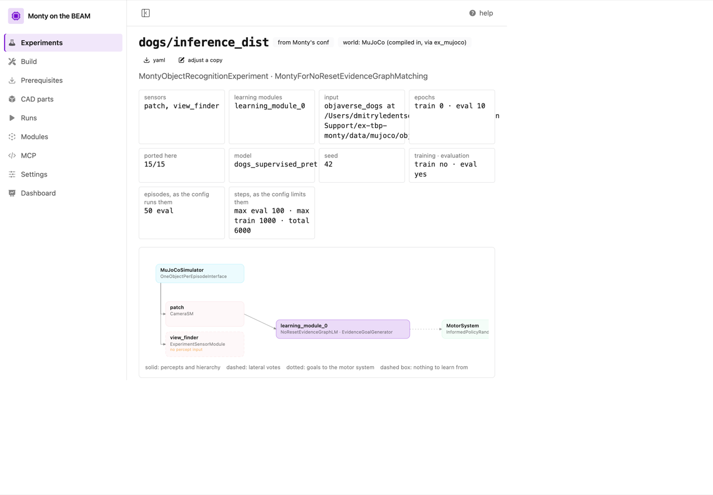
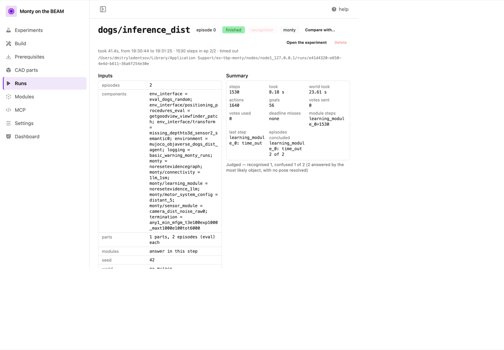

# A dog, recognised from its own scans

[The CAD walk-through](../cad/README.md) starts from a STEP file this
application makes its own memory from. This one starts from **somebody else's
scans**: five dogs imported from Objaverse, taught into a memory by a training
run, and then recognised one episode at a time.

## 1. What the experiment is

`dogs/inference_dist` is one of Monty's own configs, composed from its `conf`
tree and marked "from Monty's conf". Nothing about it is ours but the world: the
`patch` and `view_finder`, the `noresetevidence_1lm` learning module, the
`distant_5` motor system, the ten evaluation epochs and the fifty episodes are
Monty's, and 15 of 15 classes it names run here, in MuJoCo compiled into this
node.

Its `model` is `dogs_supervised_pretraining_dense` and its input is
`objaverse_dogs` — under `$MONTY_DATA/mujoco/objects/`, five dogs the importer
wrote. Both are outputs of other clicks, which is what makes this a chain rather
than an experiment:

- `mix monty.objaverse.import` fetches the scans and normalises each to 200 cm²
  of surface, so that "how big a dog is" does not change with the dog;
- `dogs/supervised_pretraining_dense` teaches one episode per rotation of each
  of the five dogs — `rotations_all`, over the corpus `train_dogs_predefined`
  names — and writes the memory `trained/dogs_supervised_pretraining_dense`. Its
  3° scan is the "dense" in the name; `dogs/inference_dist_raster` is the same
  run over the 5° memory, and is the control.

A config whose memory this machine has not trained says so and offers the click
that writes it. `dogs/inference`, the unsupervised surf-arm reading
`dogs_surf_unsupervised`, is in exactly that state here: **1 missing** — the
memory — with _train it_ beside it, and `Run it` refuses until it is there.

## 2. Run it

`Run it` steps the config as it stands; the `episodes` field above the button
takes a slice, because fifty episodes over the whole corpus is not what a person
wants to watch now. The run below is two episodes, seed 42, the config's own
world.

## 3. What the run says

2 episodes, 1 530 steps, 41.4 s of wall clock (8.2 s inside the modules, 23.6 s
in the world), and both episodes ended `time_out` — which is the design of this
module, not a failure: `noresetevidence_1lm` ends at its matching-step budget
with hypotheses left, so it resolves no pose, and the verdict is _which object it
named_.

`Judged — recognised 1, confused 1 of 2 (2 answered by the most likely object,
with no pose resolved)`. Per episode, from the run's own `eval_stats.csv`:

| episode | target          | named           | judgement      | steps | objects possible at the end |
| ------- | --------------- | --------------- | -------------- | ----- | --------------------------- |
| 0       | `milka`         | `dogs_head`     | `confused_mlh` | 1 170 | 5                           |
| 1       | `dog_free_fire` | `dog_free_fire` | `correct_mlh`  | 360   | 1                           |

Which dog an episode is about comes from the `eval_dogs_random` interface — the
five the corpus carries, at a random rotation each time — so a two-episode slice
is a slice and not a rate. The failure mode is the one worth knowing: **a head
looks like a head.** `dogs_head` is the corpus's odd member, and the measurement
that asked whether the corpus was the problem took its graph out of the memory
and ran the same episodes: still two of five, and the failing targets failed
with _new_ partners, so the corpus's composition is not the lever. The dense
memory is.

## 4. What to read next, in the order the notes order them

- **Density is the lever, and it is memory, not budget.** The 3° scan triples the
  memory (1 164 nodes over five dogs at 5°, 3 165 at 3°), and the sparse memory's
  episodes end with 587 hypotheses alive against the dense memory's one.
- **The module is the other lever.** `dogs/inference_supervised` on the _same_
  corpus concludes 5 of 5 with a pose, in 635 steps; the unsupervised arm
  recognises without a pose. Both are shipped, and they are the comparison.
- **`time_out` is not a wrong answer.** A `--no-record` run leaves the terminal
  state in a log and the judgement nowhere; a recorded run writes
  `eval_stats.csv`, and that is where `correct_mlh` and `confused_mlh` live.
- **Parallel episodes**, when fifty of these is what you want:
  [running them in parallel](../../parallel-and-live.md).

## Where it landed

| What                 | Where                                                                                       |
| -------------------- | ------------------------------------------------------------------------------------------- |
| the scans            | `$MONTY_DATA/mujoco/objects/objaverse_dogs/`                                                |
| the memory           | `$MONTY_LIBRARIES/trained/dogs_supervised_pretraining_dense.jsonl.gz`                       |
| the run's own record | the node's folder, `…/nodes/<node>/runs/<run id>/` (`eval_stats.csv`, `run.log`, `frames/`) |
