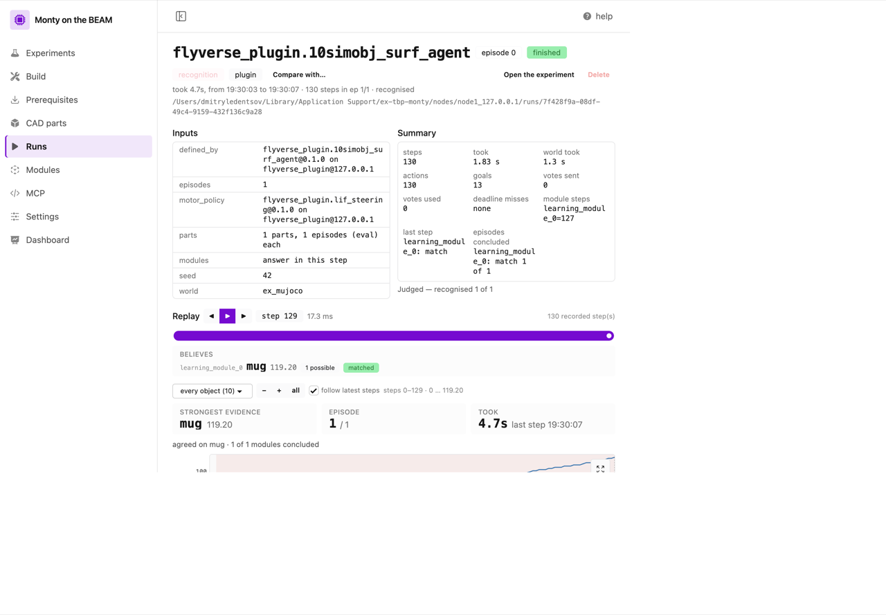

# A connectome steering a run

[The CAD walk-through](../cad/README.md) is a part becoming something to
recognise. This one is a **decision**: where the sensor looks next, taken by a
spiking network rather than by Monty's own policy.

`examples/flyverse_plugin` is a plugin host — a node in the cluster that is not
this application — and it offers two things: a motor policy that steps
[flyverse](https://github.com/djmango/flyverse)'s leaky integrate-and-fire
engine inside a Rustler NIF, and the experiment that names that policy. The
dataset it is written for is 150 MB and is in no checkout, so the pack on this
machine is a four-neuron demonstrator: what follows shows the seam working, not
a fly solving a benchmark. [The plugin's own study](../../../examples/flyverse_plugin/docs/research.md)
is where that line is drawn properly.


## 1. The experiment is somebody else's

The page's name says whose run it is, and two badges say who answered and what
will step it: `from flyverse_plugin@127.0.0.1` and
`steps with flyverse_plugin.lif_steering@0.1.0 on flyverse_plugin@127.0.0.1`.

That second badge exists because the Motor system box beside the diagram names
the **config's** policy, `SurfacePolicyCurvatureInformed` — the one this run does
not build. A definition replaces the config's motor system with the policy the
offering node registered, so a page that showed only the config would describe a
run that cannot happen. The badge says the same words the run's record writes
into `motor_policy`, so a page and a record of one run cannot disagree.

Everything else on the page is Monty's: ten similar YCB objects, the patch and
the view finder, one evidence learning module, fourteen evaluation epochs, and
13 of 13 classes ported here.

## 2. Run it

`Run it` steps the config as it stands and the policy answers once per step. The
config asks for 140 episodes — every object in every rotation — and the
`episodes` field above the button takes a slice of them, which is what this run
used: one.

## 3. What the run says



Four lines of the record are the whole story of a plugin-defined run:

| Field          | What it says                                                                                |
| -------------- | ------------------------------------------------------------------------------------------- |
| `defined_by`   | `flyverse_plugin.10simobj_surf_agent@0.1.0 on flyverse_plugin@…` — who wrote the definition |
| `motor_policy` | `flyverse_plugin.lif_steering@0.1.0 on flyverse_plugin@…` — who decided every step          |
| `world`        | `ex_mujoco` — the scene MuJoCo steps, compiled into this node                               |
| `seed`         | `42` — the base config's own, written into the definition rather than inherited             |

130 steps, 13 goals, 1.83 s inside the modules and 4.7 s of wall clock, and
`Judged — recognised 1 of 1`: the learning module concluded `match` on `mug` at
evidence 119.20. The sensor was walked there by spikes.

## 4. What decided, once per step

The policy is a value that crosses the cluster boundary and comes back with
every call — the caller holds it, the host computes it — which is why six
episodes in parallel do not share one heading. Inside, in the plugin's own words:

```
 left half   --1/depth-->  80 + 4x Hz  --> drive 0 --> readout 2 --+
                                                                    +--> difference
 right half  --1/depth-->  80 + 4x Hz  --> drive 1 --> readout 3 --+

 difference --30 ms low-pass--> wish --5 deg x tanh(wish/2)--> yaw
```

While the patch is not on the object the answer is Monty's own `_touch_object`
and the network is not asked, because an empty patch says the same thing
everywhere. [The plugin's README](../../../examples/flyverse_plugin/README.md)
has the rest: the 80 Hz tonic, the four hertz per inverse metre, the 20 ms window
stepped in 0.1 ms ticks, and why each of those is not free.

### What the network is fed, and how wide

The two halves above are the _demonstrator's_ plan, not a limit of the
interface: the pack carries `plan.json`, and the number of drive groups in it is
the number of bands the view is cut into. Two groups is a left and a right; a
pack that names one index per group is driven by a column per group, which is the
shape a retina has and the shape the dataset's sensory inventory is in. The
decision stays two-sided either way — the wish is the difference of the two
readouts, because a walk with turns in it has two.

**Two ways to drive a group.** `{:rate, hz}` is the Poisson sampler above.
`{:ticks, [[tick, ...], ...]}` is a **recording**: one list of tick numbers per
neuron of the group, in absolute ticks of the simulation's clock, which
`reset/1` sets to zero. That is what the dataset's `vnc_sensory` is — which
sensory neuron fired when, recorded rather than generated — and it is presented
by copying it in: a tick the window has not reached yet fires when the window
reaches it, a tick already behind it does not fire again, and a group of three
neurons given two lists is refused rather than guessed at.

**Two channels for it.** The default is depth: `1 / depth` of the nearest thing
in each band, capped at a 10 m horizon. `FLYVERSE_SENSOR=rgba` on the host
switches it to what a photoreceptor could answer — the luminance of the colours
the same sensor recorded, and per band the _change_ since the previous step,
taken as a magnitude because a growing dark shape looms as much as a growing
light one. Depth is still what "is the patch on the object" is asked of: that is
geometry, and a band's brightness cannot answer it. Measured on this Mac, one
episode of this config, seed 42, `ex_mujoco`:

| channel          | steps | verdict   | strongest evidence |
| ---------------- | ----- | --------- | ------------------ |
| depth (default)  | 130   | `correct` | 119.20             |
| colours (`rgba`) | 55    | `correct` | 48.58              |

Both recognised the same mug; the colour run got there in half the steps and
stopped on less evidence. Neither is "the fly's" answer, and the host setting is
which one a run uses.

What is still **not** what a fly gets is a spike train _per band from its own
eyes_: a recording can be presented, and a luminance change per band can be
computed, but nothing here derives one from the other yet — the dataset's
`sensory` replay and a rendered fly retina are the two ends, and this example has
the socket between them.

## 5. What was wrong when this page was first written

The host was up, answering rpc, and invisible: the studio answered _"no experiment
here is named … and no node in this cluster says it hosts plugins"_. The cause was
ours, in both example hosts: libcluster's `Cluster.Strategy.Epmd` dials its hosts
in `init/1` and then sleeps for `config[:timeout]`, whose default is `:infinity`
— one dial for the life of the node. A plugin host boots before the studio (it
has no HTTP to wait for) and never looked again, and a studio restart lost it for
good. Both hosts now re-dial every five seconds, and the page above is the check
that they do.

## A fly's body in MuJoCo: what is stopping us

Nothing about **NeuroMechFly** is macOS-only, and nothing about MuJoCo is
missing on this side. Checked against its own installation page
([2.1.1](https://neuromechfly.org/2.1.1/installation/)): it is `pip install
flygym`, MuJoCo arrives through the Python bindings, `flygym[warp]` is a
GPU backend, and a headless machine switches the renderer to EGL
(`MUJOCO_GL=egl`). The macOS-only note in
[the study](../../../examples/flyverse_plugin/docs/research.md) is about
**flyBrain**, whose engine and world are `#[cfg(target_os = "macos")]` Metal
kernels over MuJoCo 3.9 — not about FlyGym.

What is stopping us is three things, in the order they bite:

1. **The body speaks Python and the policy speaks Elixir.** FlyGym is a Python
   package, so a fly body would live in the Python world this application already
   carries (`world: MuJoCo (in this application)`), not in `ex_mujoco`, which is
   Rust and cannot load it. The connectome stays where it is — a NIF in the BEAM —
   and the action crosses once per window, which is the shape the plugin contract
   already has (a motor policy called once per step). That is a port, not a wall.
2. **Monty's actions are not joint torques.** `OrientHorizontal` and
   `OrientVertical` carry a yaw, a pitch and a forward distance, because the body
   they were written for is a patch agent on a camera. A fly needs its six legs
   driven — FlyGym's own controllers are CPG, rule-based, hybrid and turning
   (its tutorials 4a–4d) or muscles (tutorial 6). Bridging the two means writing a
   controller that takes Monty's action and produces leg targets, which is a small
   fly controller and not a policy option.
3. **The connectome we can simulate has no motor side to drive it.** MaleCNS gives
   neurons and synapses; it does not give the descending-neuron → motor-neuron →
   muscle mapping that a body needs, and flyverse's own README says the embodied
   fly "skitters rather than flies", reaches no meals, and takes its main sensory
   input from a canned `vnc_sensory` replay because the dataset has no ventral
   nerve cord, no muscles and no donor body state. Driving NeuroMechFly's muscles
   from that connectome would need a mapping neither dataset ships.

So the next step that _is_ ours is the second one: a Python-world fly body, and a
controller between Monty's actions and its legs. The input side is already the
socket a real retina or a real replay plugs into (above).

### A body: it is composed, and it steps

The first step towards a fly body is done and is measured, not argued:
`examples/flyverse_plugin/scripts/fly_body.py` composes a **NeuroMechFly** in a
flat MuJoCo world, with its legs drivable, and steps it.

- A bare `NeuroMechFly` is a body with **no joints and no actuators**; the legs
  become drivable when a skeleton's active leg dofs are added and a position
  actuator is named for each — 6 legs, **42 leg dofs, 42 actuators**, `nq 49`,
  `nu 48`, timestep 0.1 ms.
- The action surface a Monty action has to be mapped onto is
  `set_actuator_inputs(fly, ActuatorType.POSITION, targets)` plus
  `set_leg_adhesion_states(fly, six flags)`; the percept a fly policy would get
  back is `get_ommatidia_readouts(fly)` — **2 eyes × 721 ommatidia** — and
  `get_raw_vision(fly)`, two 512×450 RGB views.
- Driven by a crude antiphase stride it moved 5.4 cm along x in 800 steps — and
  sank 4 cm doing it. That says the actuators reach the legs; it is not a gait,
  and it is not what the numbers below are: that fly is hand-composed in the
  metre-scaled model, while the walking one is FlyGym's locomotion fly in
  millimetres.

**It needs its own interpreter.** FlyGym installs MuJoCo **3.16**; the
interpreter `priv/monty_py/world.py` runs in is pinned to **4.0.1** for reasons
`config/pythonx.exs` records, and one interpreter cannot hold both. So a fly body
is a second interpreter beside the one the BEAM carries — the shape the plugin
hosts already have — and the script says how to make one:

```sh
python3 -m venv /tmp/fly && /tmp/fly/bin/pip install flygym
/tmp/fly/bin/python examples/flyverse_plugin/scripts/fly_body.py
```

### A body that walks, and the one function between it and Monty

The gait exists, and it takes exactly the shape a Monty action has.
`examples/flyverse_plugin/scripts/fly_walk.py` puts FlyGym's locomotion fly on
flat ground and drives it with a **two-channel descending signal**:

$$
\text{descending} = [\text{left}, \text{right}], \qquad
\text{forward} = \text{left} + \text{right}, \qquad
\text{turn} = \text{left} - \text{right}
$$

`HybridTurningController.step(descending, observation)` answers with joint
targets and six adhesion states, `apply_locomotion_action` hands them to the
body, and the body moves. Measured on this Mac, flat-ground world,
`make_locomotion_fly`, one second per command:

| command              | displacement        | heading     |
| -------------------- | ------------------- | ----------- |
| `[1.2, 1.2]` forward | 14.6 mm x, 4.6 mm y | +16.4°      |
| `[0.4, 1.2]` left    | 7.7 mm y            | **+148.7°** |
| `[1.2, 0.4]` right   | 8.1 mm y            | **−143.2°** |

So the sign of `left − right` is the sign of the turn, and a symmetric command is
a stride: the body answers a command in Monty's own terms. Monty says
`OrientHorizontal(angle, distance)`; the descending signal is
`[forward + turn, forward − turn]` with the two scaled to the body's gains, and
the percept comes back as 2 eyes × 721 ommatidia (`get_ommatidia_readouts`) or
two 512×450 views (`get_raw_vision`, and that path is what
`get_ommatidia_readouts` renders from — a fly needs `add_vision()` first, or it
raises rather than guessing).

What is left is not the body any more: it is a world interface in Elixir that
owns this interpreter and steps it once per action, the mapping's two gains, and
a walk-through page over the result.

### The body on the port that already exists

The Elixir side needed no new contract. `Monty.Simulators.Port.Environment`
already starts a simulator as a _command_ and speaks
`Monty.Simulators.Port.Protocol` — length-prefixed JSON, `reset` and `step`,
Monty's own action maps in and `observations` + `proprioceptive_state` out. So a
fly body is a **peer script**:
`examples/flyverse_plugin/scripts/fly_peer.py`, checked end to end against the
framing by `fly_peer_check.py` in the same directory (a foothold check that runs
without the application).

What it is measured to do, on this Mac, flat-ground world:

| request                     | asked | arrived    |
| --------------------------- | ----- | ---------- |
| `orient_horizontal` forward | 5 mm  | 5.2 mm     |
| `orient_horizontal` left    | +25°  | **+26.3°** |
| `orient_horizontal` right   | −25°  | **−22.2°** |

Two things that measurement taught, both now written into the script:

- **A turning _gain_ would be a fiction.** The same differential turns the body
  119°/s one way and 352°/s the other (`[1, −1]` → −23.8° in 0.2 s, `[−1, 1]` →
  +70.5°), because the gait is not symmetric in open loop. So the turn is
  **closed on the heading**: each body step measures how far the body still is
  from the heading the action named and leans the differential that way.
- **A fly's percept is 1442 numbers, not a camera frame.** `get_ommatidia_readouts`
  answers 721 ommatidia per eye, each reading one of two photoreceptor types
  (yellow and pale) with a zero in the other column — 1.4 kB per eye. The raw
  eye render is 512×450×3, 1.2 MB per eye per step, which is a camera's percept
  and not a fly's. The peer sends the ommatidia.

### The world, in Elixir

`Monty.Simulators.Flygym.World` is the world a run threads: it implements
`Monty.Simulators.Environment` and starts the peer through
`Monty.Simulators.Port.Environment` with
`command: [interpreter, priv/monty_py/fly_peer.py]`. The script ships with the
application; the **interpreter** is what a machine supplies, named by
`FLYGYM_PYTHON`. `available?/0` answers before a run is opened and
`unavailable_reason/0` says what to set, so a node without one refuses the
experiment instead of failing inside it — the same shape `ExMujoco.World` has
for a machine without OpenGL.

`test/monty/simulators/flygym/world_test.exs` drives it the way a run does —
`OrientHorizontal` in, the motor system's own `AgentState` out — and asserts a
5 mm stride arrives within a millimetre, that +25° and −25° turn opposite ways,
and that each eye reports 721 ommatidia. Without `FLYGYM_PYTHON` the five cases
skip with the reason, so CI stays green and a machine with the body proves it.

### The percept, and the page

`Monty.SensorModules.Transforms.Ommatidia` turns the eyes into a percept a
learning module can store, and `docs/monty-differences.md` §2.51 writes down that
**none of it is Monty's** — Monty has one sensor module, `CameraSM`, which reads
an RGBA patch and a depth image a fly has neither of:

- the **features** are the eye, flattened, in the body's own order;
- the **location** is the body's own position, because a compound eye has no
  depth to put a surface point at;
- the **pose** is the body's own orientation, as an `OrientationMatrix` with
  `pose_fully_defined`, which is what a fly does know;
- `on_object` is 1 and the semantic id is 0: a fly sees the world and no labels.

`/fly` in the studio is the walk-through: press **Forward 5 mm**, **Turn left 25°**
or **Turn right 25°** and the body walks; the page draws the path, says where it
is and what it faces, and draws the first of the eye's numbers. It starts no body
until a press, and stops the one it started when you leave.

The page's other state is the one a machine starts in: **no interpreter with
FlyGym**, with the reason and the two commands that fix it, printed with this
machine's own path. The body is looked for in two places, in this order:
`FLYGYM_PYTHON`, and then `<data dir>/fly/bin/python` — the application's own data
directory, which is where those commands put one. So a machine is one paste away
from a body, with nothing in the repository carrying an absolute path and no
restart needed: the page asks at mount, and the interpreter is found on the next
reload. `process-compose.yaml` still carries a commented `FLYGYM_PYTHON` beside
node1's settings, for a machine that wants its interpreter somewhere else.

What is left: a config that names this world, so a _run_ uses the body rather than
the page. That is a product decision about a config key Monty's own YAML does not
carry, and it is written down as one rather than invented here.

## Starting it yourself

```sh
cd examples/flyverse_plugin && mix deps.get
mix flyverse_plugin.pack ../../tmp/flyverse-pack   # once: the pack is data
process-compose up                                 # four processes: two studios, two hosts
```

then
[the experiment](http://localhost:4001/experiments/flyverse_plugin.10simobj_surf_agent)
on either studio node. A host whose pack is missing still starts and refuses a
policy with the sentence that names the command above, rather than inventing a
connectome to stand in for one.

## What it does not claim

- **The demonstrator is not a fly.** Four neurons and two edges; its behaviour is
  a statement about the wiring `mix flyverse_plugin.pack` wrote.
- **With the dataset, the policy's answer is a question.** flyverse's own README
  is the honest frame: the embodied fly skitters rather than flies, its haltere
  probe found no steering response to an imposed rotation, and its main sensory
  input is a canned replay. A policy driven by that connectome is an experiment,
  not a result.
- **Nothing here ran against the 150 MB connectome.** The plan a person would
  write for the real pack is untested, and the first thing to check is that the
  group indices it names are the ones the dataset's own annotations give.
