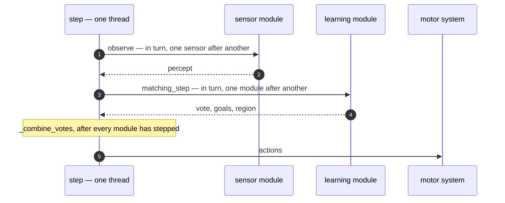
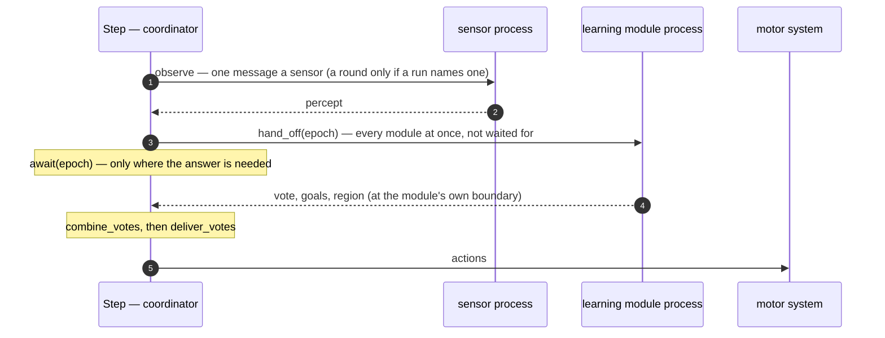
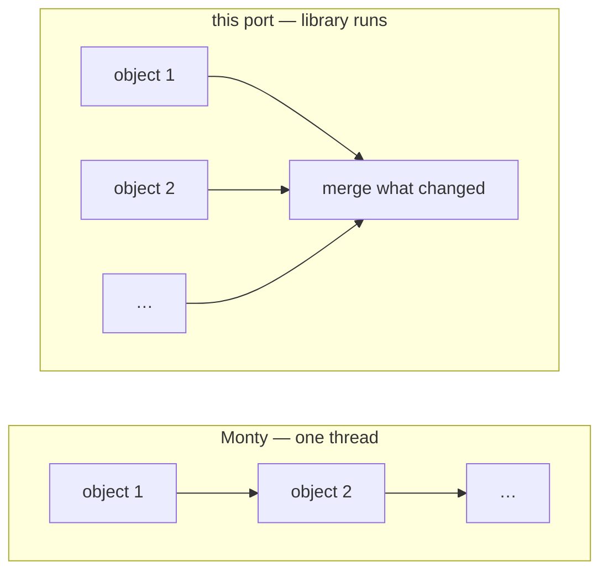
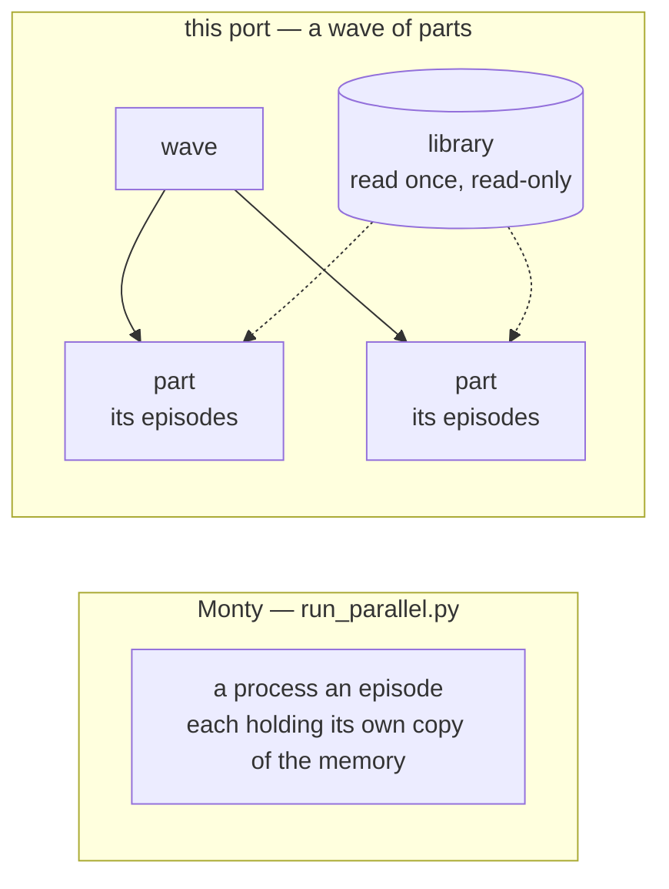
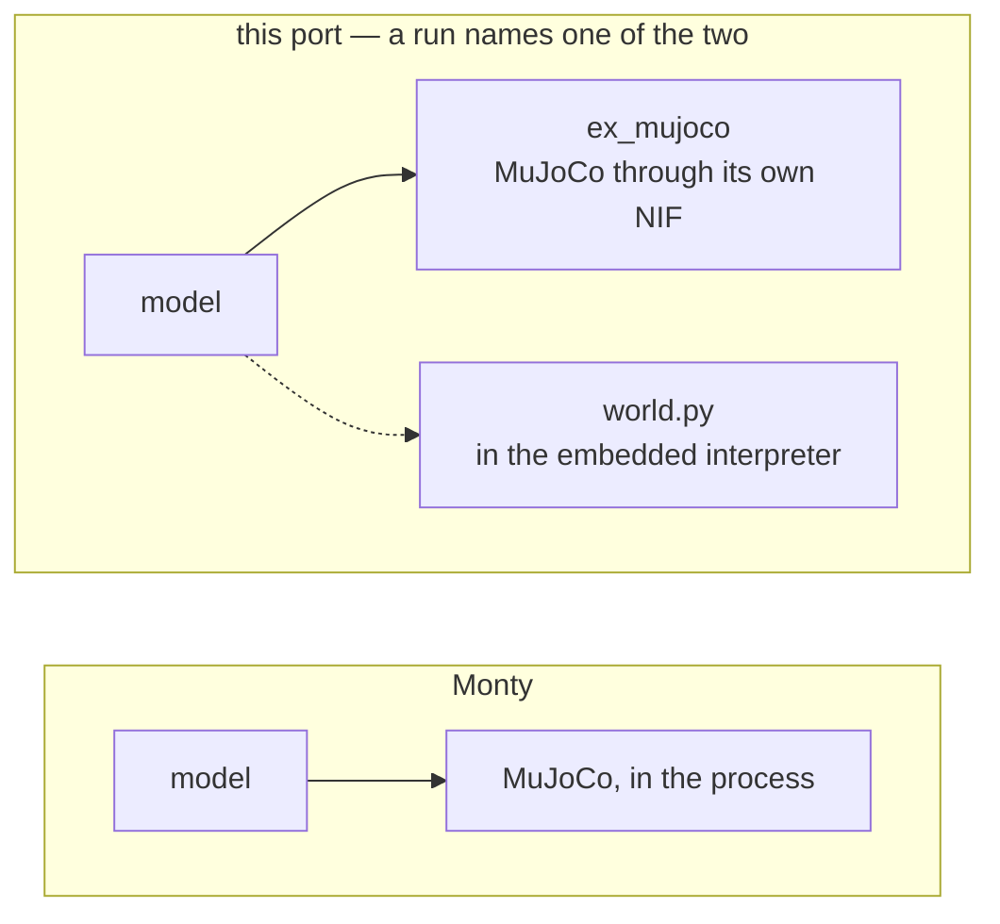

# Speed

Where a step's time goes, what was fixed, and what is still open.

**No figures on this page, on purpose.** A wall clock on a busy machine moves by
several times over one afternoon, and a number written down here would be quoted
long after the machine that produced it is gone. The commands below print the
numbers; run them on the box you care about. The one exception is a measurement
that says which box, which world and which workload it came from, because a
comparison between two rounds is worth nothing without them — those are marked
"measured" and are the only numbers here.

## The honest position

Run-times are **mostly comparable to Monty's, and sometimes slower on our side**.
Measured against Monty's own runner with the same config and seed on the same
machine, the two agree closely on some configurations and we trail on others.

Three things make us the slower of the two when we are:

- **The world crossing.** Monty's MuJoCo is a function call in its own process.
  Ours is a port: one crossing a step, carrying the sensor images as bytes, with
  the encode and the decode on either side of it.
- **The studio around the step.** A step is recorded, streamed, and drawn on a
  page. Monty's runner does none of that, and an open page costs us through
  contention rather than through drawing.
- **The runner, not the port.** `mix monty.run` builds a world and a model per
  episode; the studio's job reuses both. Two runs of the same config through
  different runners are therefore not comparable at all.

What we are not paying for: the algorithm. Steps are Monty's, one for one — the
adaptations are listed in [`monty-differences.md`](monty-differences.md), and each
one pays a reduction in work or is a decision about a boundary, never extra
stepping. On the hot arithmetic we are ahead: the evidence maths and the graph's
index are native kernels, the hypothesis columns are held as bytes, and the slope
tracker is a ring rather than a sliding list.

**Quote steps across runners, never a wall clock.** Steps are the port's own
measure; a wall clock is the machine's.

## How to measure, and what lies

| what                             | how                                                                                                                                             |
| -------------------------------- | ----------------------------------------------------------------------------------------------------------------------------------------------- |
| work and garbage per step        | `MIX_ENV=test mix run scripts/probe_step_cost.exs [experiment] [steps]`                                                                         |
| where in a step it is            | `MIX_ENV=test mix run scripts/probe_step_phases.exs [experiment] [steps]` — the world against the model, a processed step and a plain one apart |
| who did the work                 | the same script — reductions per process, labelled by callback module                                                                           |
| allocation per function          | `MIX_ENV=test mix run scripts/probe_step_profile.exs` (tprof over one `Model.step`)                                                             |
| the split inside one run's log   | `mix run scripts/probe_run_log.exs priv/studio_runs/<id>` — a step's own `duration_us` against the wall between lines                           |
| the whole run, as a user sees it | `mix monty.run <experiment> --episodes 1 --steps 8 --no-record` — the acceptance ladder                                                         |
| Monty's own share of its step    | `cProfile` inside Monty's venv, one epoch                                                                                                       |

- **Wall clock is not usable here.** The same step has measured several times
  longer in one afternoon than in another, following whatever else the machine
  was doing; a machine in swap makes a small copy take a second. Reductions
  (`:erlang.statistics(:reductions)`) and reclaimed words
  (`:erlang.statistics(:garbage_collection)`, MB = words / 125 000) do not move
  with load. Check `sysctl vm.swapusage` before believing any timing.
- **One run cannot resolve a few percent.** The same probe reads a range of
  reductions and of megabytes between runs. Quote a pair measured in one run,
  interleaved against the tree before it, or quote nothing.
- **The probes drive different steps.** `probe_step_profile.exs` calls
  `Model.step` with a recording sensor — no MuJoCo, no studio.
  `probe_step_cost.exs` calls `Studio.Run.step`. Their totals are not comparable.
- **Tell a slow machine from a slow port** with `probe_run_log.exs`: the step's
  own `duration_us` against the wall between lines. When both rise together it is
  CPU starvation, not code.
- `:tprof` needs `rootset: :all` and OTP 29's `:profile/2` takes a _map_:
  `:tprof.profile(fun, %{type: :call_memory, rootset: :all, report: {:total, {:measurement, :descending}}})`.
  There is no `analyse/2`; without `rootset: :all` the table is one
  `gen:do_call/4` row. `:eprof` prints an empty table for a step whose work
  happens in other processes, and `:fprof` writes hundreds of megabytes.
- **Instruments that mislead.** `:tprof.profile(fun, %{rootset: [pid], …})` does
  not narrow the report to that process. `:eprof` counts a process's _idle_ time
  into `gen_server:decode_msg/4`, so only compare busy functions within one table.
  `Process.info(pid, :current_stacktrace)` sampling reports "waiting" for every
  module held at a barrier: a sample answers "who is not running", never "who is
  not the cost".

## What a step is made of

Five things, and only two of them are the port's arithmetic:

1. **The model** — the learning module's own work: hypotheses, evidence, the
   kernels, the votes.
2. **The world behind the port** — one crossing a step, carrying depths, colour,
   segmentation, a header and the arrays' bytes. The Python half is all of its
   cost: MuJoCo, numpy and the encode. There is nothing left to win on our side
   of the crossing.
3. **The record** — the step's entry, the moment, the files a step writes and
   the CSV row.
4. **The episode boundary** — positioning (`GetGoodView`), which is the
   experiment's, and a rebuild of the scene, which a runner may or may not do.
5. **The page** — a step's scalars, a drawing on an interval. What it costs is
   contention with the step, not the drawing.

The model and the world are inside `Run.step`, so they are the two that can be
attributed exactly. The rest sit around it.

## What is different from Monty, and what each difference bought

Monty steps one thread and calls everything from it. This port hands the same
calls to processes, and the decisions are Monty's: the differences are where the
work runs, and how much of one step's work is taken at once. Each one carries the
measurement that decided whether it is on.

| what differs          | Monty                         | here                                           | measured                                          | on?                      |
| --------------------- | ----------------------------- | ---------------------------------------------- | ------------------------------------------------- | ------------------------ |
| asking the sensors    | in turn, one thread           | in turn; a round only if a run names one       | a round of two costs 0.8–1 ms a step more         | **no**, by default       |
| a module's step       | a call on the caller's stack  | handed to the module's process, awaited        | the precondition for the rest                     | yes                      |
| the objects of a step | a fold in the caller's thread | a loop, as Monty's; a round on request         | 4 % more reductions in a round (5-module episode) | **no** — measured a loss |
| a module's vote       | in the coordinator            | a loop, as Monty's                             | 5.5–8.2 ms loop against 16–44 ms in a round       | **no** — a round loses   |
| the episodes          | a process each, memory copied | parts of one run, one library                  | 1.7×, and 2.07× on an earlier pair                | yes                      |
| a graph's top nodes   | a full sort                   | partition, then sort the tail                  | 94 → 13 µs at 2 000 nodes, 4 007 → 306 at 40 000  | yes                      |
| the world             | MuJoCo in the same process    | `ex_mujoco`'s NIF, or the embedded interpreter | ~9 ms a step compiled against ~33 through it      | compiled by default      |

The diagrams below are the four that are structural. The message-level sequence
diagram of a step is in [`architecture.md`](architecture.md); these are the
shapes that changed, with the boxes a comparison needs and no more.

### Monty's step, and this port's

The boxes are the same four because the _decisions_ are the same four; what moved
is that a module's step is no longer on the coordinator's stack (§2.29), and the
vote round is the only place the coordinator waits (§2.30). Sensors are asked in
turn by default — Monty's order — because a round of two measured 0.8–1 ms a step
_slower_ here (`What a round is worth`).

### Inside one graph update: a loop, or a round

Monty folds over the objects of a memory in the caller's thread. A run that reads
its memory from the library takes them in a round, one process an object, and
merges what each half changed; a memory the run built itself keeps the loop,
because a task is handed a copy of what its closure holds (§2.44, §2.45).

Measured on one 26-step episode: 1.61–1.70 s of model time as a loop against
1.42–1.51 s as a round, every field of every step equal. Both paths stay
callable and are compared exactly (`evidence_graph_lm_parallel_test.exs`).

### Episodes: processes with a copy, or parts of one library

Monty's workers cannot share a mutable object graph, so each re-reads the memory
and the results are files concatenated afterwards. Here the library is immutable
data a task reads without a copy, and the parts are the run's own record — which
is why the division is a speed-up and not a change of experiment (`Episodes in
parallel, measured`, `parallel-and-live.md`).

### The world: a call in the process, or a crossing

Both crossings are honest ones — the compiled world steps a scene MuJoCo renders
from the same config, the interpreter runs Monty's own `world.py` — and they are
different sizes: a step costs ~9 ms of world time compiled and ~33 ms through the
interpreter, of which ~19 ms is the render itself. Nothing this side of either
crossing is a large share any more: 0.1 ms an image for the decode, ~1.1 ms an
image for the unprojection (`The budget, as rules`, rule 5).

## What a step was paying for, and what changed

Each of these is a defect that was found by measuring, fixed, and pinned by a
parity test that compares the new path with the Elixir reference **exactly**:

- **A step copied a module's memory into the module.** `Model.state/1` handed a
  whole model's state across the boundary once per episode to write one row.
- **A surface normal walked the patch nine times** — nine passes to compute one
  vector, now one.
- **The slope tracker slid lists.** Every window of every hypothesis moved one
  slot per update, which was the single largest allocation in the module. It is
  a ring of floats with one shared cursor now.
- **A burst sorted the whole graph to keep a few hundred nodes.** `top_indices/2`
  now partitions the column at the boundary of the last `count` and sorts only
  that tail: 2 000 nodes 94 → 13 µs, 10 000 nodes 726 → 84 µs, 40 000 nodes
  4 007 → 306 µs on a column of f64 (this Mac). The answer is the same list, and
  `top_indices_native_parity_test.exs` holds it there over ties, both zeroes, a
  node with no answer and more nodes than the burst keeps.
- **A burst recomputed what it had already made**: its rotations, its on-object
  pixels, its alignment and its node block. Each is kept or taken in one pass.
- **The evidence column decoded per value.** Holding it as bytes was _worse_
  until every bulk read had a kernel of its own — the lesson of the four column
  changes: a column earns its encoding only when its readers do.
- **Half a step was a process spawn**, and a copy that followed. Both are gone.
- **The step's road to the page is one way.** A step publishes; the writer
  consumes and may lag. What still sits on the step is the entry, the moment,
  the files and the CSV row.
- **The transcript was rewritten whole.** A step appended its row by rewriting
  every row before it, which made the cost of a step grow with the length of the
  run. Now the row is left alone and the two arrays are appended.

### What the native kernels cover

Seven kernels in two Rustler crates (`native/kd_tree_nif`, `native/matcher_nif`):
feature evidence, neighbour evidence, principal curvatures, displaced locations,
window slopes, spread of one channel's evidence, and the graph's flattened arrays
with its k-d index. Each keeps a runnable Elixir reference and a parity test,
because a kernel performs the reference's arithmetic in the reference's order.
`config :ex_tbp_monty, native_kernels?: false` gives the reference path.

## The 77-object memory, measured

The largest memory the releases carry is what the lazy spec was for, so it is
also the cheapest thing to check it against. `mix monty.run
base_77obj_dist_agent --episodes 1 --steps 8` on this Mac, the stand-in scene:
eight steps, **4.3 s of model time** against 0.09 s of world — about 0.5 s a
step, with 1 200 … 5 900 hypotheses alive and 4 … 28 objects still possible.
Against the stand-in the _results_ are not the experiment's, which is what the
run says in its own header; the number worth having is that the run starts and
steps at all, and what a matching step costs on seventy-seven objects.

## A page watching a run

Measured 2026-11-17 on the dev cluster (node1, `dogs/surf_unsupervised`, 7 800
steps at about twenty a second, one run page open):

| after | page memory | messages queued |
| ----- | ----------- | --------------- |
| 1 min | 19 MB       | 172             |
| 2 min | 28 MB       | 471             |
| 6 min | **59 MB**   | **2 910**       |

The page never caught up: it was drawing a step thousands behind the run, and
every step it answered was a live rebuild. `eprof` on the page process named
it — `Replay.recorded/1` ran **fifty times in five seconds**, each pass walking
every step the run had ever taken, and the coalescing the page documents never
engaged because `refreshed_at` was written only on the run's `finished` path.

Two changes, both pinned:

- **The numbers are kept as they arrive** (`Monty.Studio.Replay.Digest`). A line
  keeps its lowest, highest and latest point per group of steps and merges
  neighbours when it has too many, so a run of any length holds at most
  `3 * 512` points a line and appending a step costs a step's work. A run short
  enough to keep every step keeps exactly what it kept before.
- **A burst of steps is one rebuild.** Each rebuild stamps when it finished, so
  the steps behind it wait for the page's own window (`run_refresh_ms`, 250 ms
  by default) instead of each paying a rebuild of its own — at most four a second
  however fast the run goes.

A stopped 14 360-step page held 56 MB before the change (the record 29, the
catalog 10, the series 7, the chart 6) and one refresh of it cost 90 ms of
recomputation plus 0.43 s of render.

## What a round is worth

Three places in this port do work in a round instead of in a loop. Each was
measured on both sides, and each answers a different way — which is the reason
the measurements are here rather than a rule about rounds:

| round                | loop                               | in a round   | verdict                                                      |
| -------------------- | ---------------------------------- | ------------ | ------------------------------------------------------------ |
| an object's evidence | 4 857 k reductions a step          | 5 058 k      | **not taken**: the copies cost more than the fan-out (§2.45) |
| a module's vote      | 5.5–8.2 ms, ten objects, 162 votes | 16–44 ms     | **rejected**: a vote is half a millisecond of work           |
| a step's sensors     | 3.43–3.53 ms a step                | 4.30–4.50 ms | **rejected as the default**; a run may still name it         |

The numbers are from this Mac (Apple Silicon, macOS 26), the MuJoCo world
through `ex_mujoco`, and two runs per arm of `base_10simobj_surf_agent` started
from the studio's run form (eight episodes of 32 steps, seed 42) for the
sensors, the ten-object library for the vote, and the five-module
`randrot_noise_10distinctobj_5lms_dist_agent` episode for the objects — counted
over the model's own work after warm-up, because a whole run's wall clock hides
the difference behind its setup (`§2.45` has both counts). The
lesson they share is the one worth keeping: **a round pays only where the work it
spreads out is bigger than the process it starts**, so measure the per-object
loop before fanning it out.

## Episodes in parallel, measured

Monty's `run_parallel.py` divides an experiment between processes. Here a run's
episodes are divided between parts and performed at once (`Partition`,
`Jobs.Run.run_wave`), and the division is only admissible because two runs of it
must take the same steps as one — which is checked in
`test/monty/studio/jobs/run_test.exs` and was what found a renderer bug in
`ex_mujoco` (`parallel-and-live.md` §5).

**Measured**, this Mac, `ex_mujoco`, `base_10simobj_surf_agent`, seed 42, eight
episodes (498 steps) started from the studio's run form: **one part 12.4 s,
two parts 7.3 s — 1.7×** with the same steps per episode. The earlier pair on
the same box and world — eight episodes of the stand-in scene, 256 steps — was
**63.2 s in one part against 30.5 s in four, 2.07×**. The ratio follows the
episodes, not the parts: a divided run is a quarter of the clock at four parts
only while there are episodes enough to fill them, and a single expensive episode
divides not at all.

## The open decision: one crossing

A matching burst walks the hypothesis set many times: with an index, through
`Enum.map`, and once per stage of the evidence maths. The change that matters is
one call that carries a burst's whole non-RNG path — displace → neighbour
evidence → spread over every hypothesis → blend with the past → slope windows →
possible mask → argmax — and hands back the columns the module keeps.

It has to stay separable, because the sampling half draws from the RNG stream and
must keep doing so in Monty's order: the burst's _shape_ (where new hypotheses
go) stays in Elixir; what they earn, and every pass over what already exists,
crosses once.

Two vehicles, both keeping the Elixir reference and its parity tests:

- **Extend `native/matcher_nif`.** No new dependency, rides the crate that is
  already built and tested in CI, and the rows are scalar loops that need no
  compiler. Costs: hand-written Rust for each stage, and the RNG must stay on the
  Elixir side by construction.
- **Add `nx` + `exla`.** The standing ask on record, and the array ops are what
  Nx is for. Costs: a compiler dependency, a large addition to the release, an
  EXLA build in CI, and a `defn` boundary per stage.

**This is an open decision.** It is written down here rather than half-made in
the code.

## Acceptance for any speed change

1. Save the ladder before the change and print it after:
   `mix monty.run base_config_10distinctobj_dist_agent --episodes 1 --steps 8 --no-record > before.txt`.
   After a change that only moves work around, the eight lines are identical.
2. A parity test compares the new path with the reference **exactly** (`==`), not
   approximately, and the reference stays callable behind
   `config :ex_tbp_monty, native_kernels?: false`.
3. Quote a pair of measurements from one run, interleaved against the tree
   before it; never a single wall-clock number.
4. `scripts/quality.sh` prints `quality: ok`, and formatting is bare
   `mix format` — `mix format <dir>` does not reach files nested below it, and a
   subset `--export-coverage` poisons the `mix complexity` gate with functions
   that are simply not covered by that run.

## Tried and rejected

- **`Geometry.mul/2` and `Geometry.apply/2` written out as 3×3 formulas.** The
  arithmetic is identical and the change measured below the noise floor on this
  machine. Reverted: the code stays the simple version.
- **Nesting binary concatenation to rewrite one column of a ring.** The first cut
  of the slope tracker wrote each row with `<<skipped, value, rest::binary>>`,
  which copies the remaining tail at every row — quadratic in the hypotheses. It
  cost more than the list shifting it replaced until the pieces were gathered and
  joined once with `IO.iodata_to_binary/1`, which is when the win appeared.
- **A per-episode copy of the model's state**, kept only as long as it is the
  thing being measured; a training phase would pay it per epoch.
- **A per-object pass over a memory's graphs**, measured rather than argued
  (`scripts/probe_lm_graph_split.exs`, this Mac, the ten-object
  `pretrained_ycb_v10/surf_agent_1lm_10distinctobj` memory, the first percept of
  `test/fixtures/monty_pretrained_episode.jsonl`). Two reasons it is not a
  scheduler change:
  - a task receives the term its closure captured, so ten tasks copied the
    24.7 MB memory each: serial 18 ms against **690 ms** for `async_stream`
    (0.03×). Naming the memory in a task that reads it from `:persistent_term`
    instead captures **3 words** and turns the same ten calls into 9 ms serial
    against **6 ms** parallel — **1.5×**, on ten objects costing 4 001 … 73 493
    reductions. The per-object share of `compute_possible_matches` on this
    percept is 98.2 %, so that ratio is what a pass divides, not more.
  - `update_evidence/4` threads **one** updater through the graphs, and the
    burst sampler's updater keeps the single slope tracker that spans every
    hypothesis. A pass is only equivalent if each task hands back its tracker
    slice and the parent concatenates them in graph order — so the work is a
    slice-and-merge refactor of the tracker, with the evidence ladder as its
    referee, and it is worth starting only from the held-library case above.

## The budget, as rules

1. **The maths first.** Fewer steps than Monty for the same episodes is the
   target, and it is met on the configs that have been compared.
2. **No partitioning inside a step to go faster.** Concurrency worth spending
   effort on is inside a step, and only where a measurement says so: the objects
   of a graph update pay for a round (`§2.45`), the vote does not, and a phase of
   two sensors does not (`What a round is worth` above). Between episodes it is
   different — the division is exactly as parallel as the episodes are
   independent, and it is measured there too.
3. **A queue, not a call.** A step publishes; I/O, PNG encoding and the page
   consume and may lag. `RunStream` is that shape already — a cast plus an ETS
   table the writer reads.
4. **Measure before moving anything off the step.** What is neither model nor
   world has to be split per piece before it is queued or made asynchronous.
5. **The world has been re-measured, and the two worlds are not one number.** A
   step of the Python world (`world_simulator: :mujoco`, the interpreter's own
   `world.py`) costs ~33 ms of world time, of which ~19 ms is MuJoCo rendering
   through `Pythonx` — the interpreter is most of that crossing, and nothing on
   this side of it changes that. A step of the compiled world
   (`world_simulator: :ex_mujoco`, what the page offers first) costs ~9 ms. On
   either, this side of the crossing is small: 0.1 ms an image for the answer's
   decode and ~1.1 ms an image for the unprojection (`tmp/probe_world_crossing.exs`
   measures the two on a 64×64 image; `tmp/probe_world_profile.exs` splits the
   world step with tprof, which is honest there because no task is started in it).
   A native unprojection would buy a millisecond or two a step at the price of
   changing the shape every reader of `semantic_3d` sees, so it is not taken.
