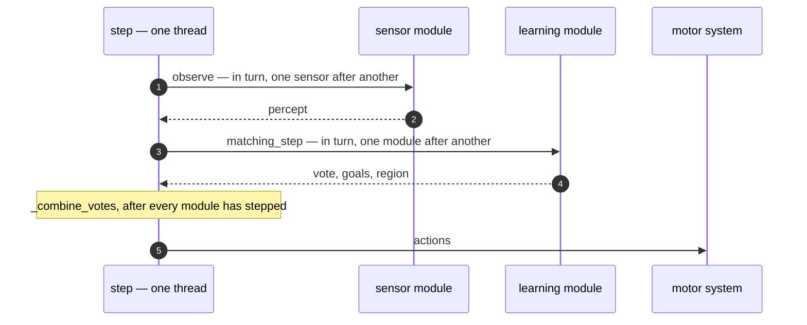
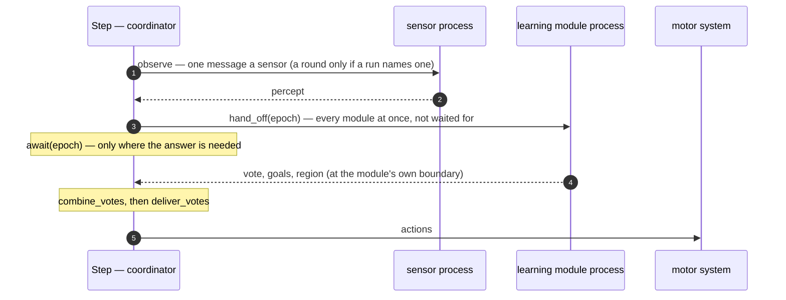
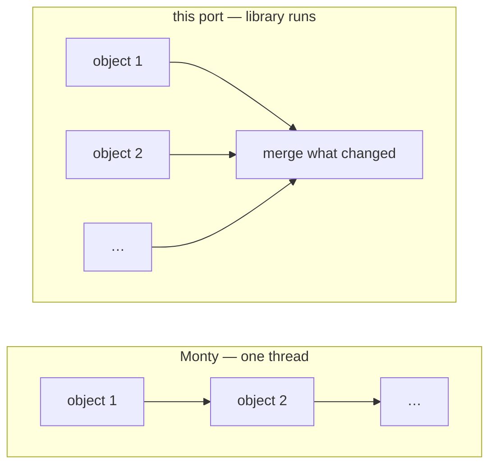
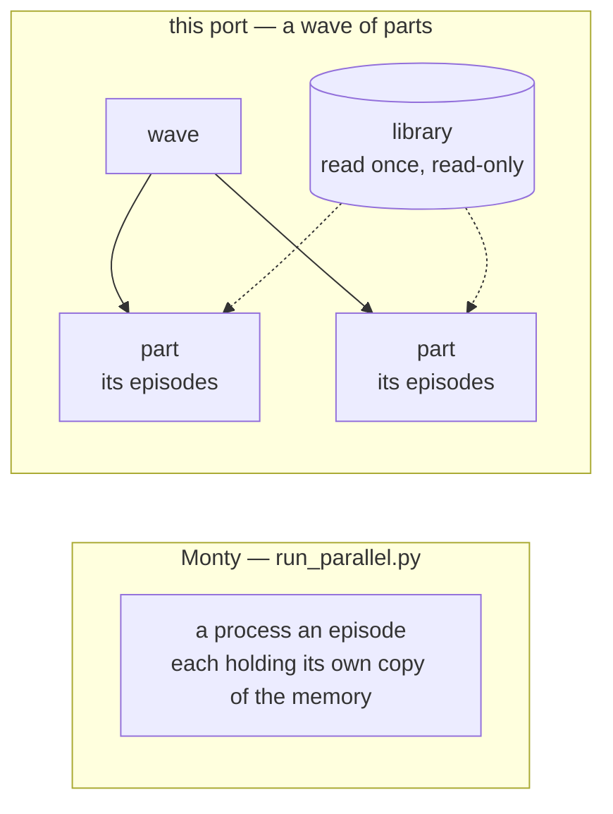
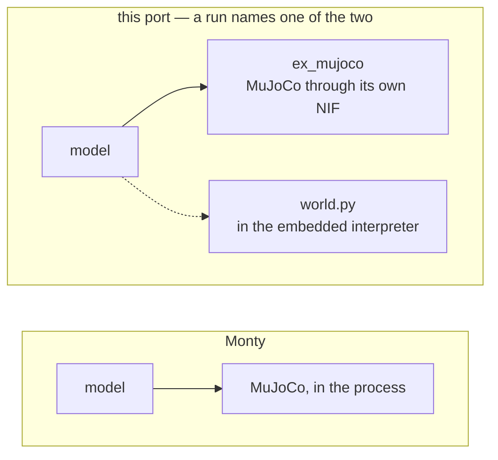

# Speed

Where a step's time goes, what was fixed, and what is still open.

**No figures on this page, on purpose.** A wall clock on a busy machine moves by
several times over one afternoon, and a number written down here would be quoted
long after the machine that produced it is gone. The commands below print the
numbers; run them on the box you care about. The one exception is a measurement
that says which box, which world and which workload it came from, because a
comparison between two rounds is worth nothing without them — those are marked
"measured" and are the only numbers here.

## The honest position

Run-times are **mostly comparable to Monty's, and sometimes slower on our side**.
Measured against Monty's own runner with the same config and seed on the same
machine, the two agree closely on some configurations and we trail on others.

Three things make us the slower of the two when we are:

- **The world crossing.** Monty's MuJoCo is a function call in its own process.
  Ours is a port: one crossing a step, carrying the sensor images as bytes, with
  the encode and the decode on either side of it.
- **The studio around the step.** A step is recorded, streamed, and drawn on a
  page. Monty's runner does none of that, and an open page costs us through
  contention rather than through drawing.
- **The runner, not the port.** `mix monty.run` builds a world and a model per
  episode; the studio's job reuses both. Two runs of the same config through
  different runners are therefore not comparable at all.

What we are not paying for: the algorithm. Steps are Monty's, one for one — the
adaptations are listed in [`monty-differences.md`](monty-differences.md), and each
one pays a reduction in work or is a decision about a boundary, never extra
stepping. On the hot arithmetic we are ahead: the evidence maths and the graph's
index are native kernels, the hypothesis columns are held as bytes, and the slope
tracker is a ring rather than a sliding list.

**Quote steps across runners, never a wall clock.** Steps are the port's own
measure; a wall clock is the machine's.

## How to measure, and what lies

| what                                | how                                                                                                                                             |
| ----------------------------------- | ----------------------------------------------------------------------------------------------------------------------------------------------- |
| work and garbage per step           | `MIX_ENV=test mix run scripts/probe_step_cost.exs [experiment] [steps]`                                                                         |
| where in a step it is               | `MIX_ENV=test mix run scripts/probe_step_phases.exs [experiment] [steps]` — the world against the model, a processed step and a plain one apart |
| who did the work                    | the same script — reductions per process, labelled by callback module                                                                           |
| allocation per function             | `MIX_ENV=test mix run scripts/probe_step_profile.exs` (tprof over one `Model.step`)                                                             |
| the split inside one run's log      | `mix run scripts/probe_run_log.exs priv/studio_runs/<id>` — a step's own `duration_us` against the wall between lines                           |
| the whole run, as a user sees it    | `mix monty.run <experiment> --episodes 1 --steps 8 --no-record` — the acceptance ladder                                                         |
| how much of the machine a step uses | `MIX_ENV=test mix run scripts/probe_step_busy.exs [experiment] [steps]` — `:msacc` per scheduler: running, GC, idle, and the dirty-CPU share    |
| one graph's k-nearest search        | `MIX_ENV=test mix run scripts/probe_nearest_cost.exs [experiment]` — a live graph's positions and its real query rows                           |
| Monty's own share of its step       | `cProfile` inside Monty's venv, one epoch                                                                                                       |
| **inside a NIF**                    | `/usr/bin/sample <beam pid> 5 -file out.txt` on this Mac — no Xcode needed, and the leaf frames name the Rust (`Rust` below)                    |

**What a native sampler can and cannot tell you here.** `perf` and OTP's
`+JPperf` are Linux; on macOS `sample` (or `xctrace`) attaches to `beam.smp` and
survives nothing about the BEAM: every Elixir frame is an unnamed JIT block
(`??? (in <unknown binary>)`), so the Elixir half stays with reductions, tprof and
the step split above. What it does answer is _which Rust function_ is hot — and it
does so on the release build we ship: the `.so` files keep Rust's v0-mangled
names, so a leaf reads
`_RINvMNtNtNt…5kiddo5float5query9nearest_n…` and `matcher_nif::slope_at`. `nm` is
a poor probe for the same reason — `lto = true` inlines the small functions into
the NIF entry, so `grep nearest_many` finds nothing while the tree shows
`nearest_n_recurse`. A build with `CARGO_PROFILE_RELEASE_DEBUG=1
CARGO_PROFILE_RELEASE_LTO=false` adds line numbers and splits more functions out,
which is worth it only when a frame is still a mystery.

Measured that way on the ten-object config, five seconds of matching steps: the
k-d tree's own search (`kiddo`, `nearest_n_recurse`) is 634 samples, **`acos` 173**,
BEAM's heap sweep and GC 284 together, and the matcher's entry points a few dozen
each. The `acos` is `angle/2` in `matcher_nif` — Monty's own
`SpatialArithmetics.get_angle/2`, one or two a node — so it is the price of the
arithmetic and not a defect; it is also the ceiling of any future micro-work there.

- **Wall clock is not usable here.** The same step has measured several times
  longer in one afternoon than in another, following whatever else the machine
  was doing; a machine in swap makes a small copy take a second. Reductions
  (`:erlang.statistics(:reductions)`) and reclaimed words
  (`:erlang.statistics(:garbage_collection)`, MB = words / 125 000) do not move
  with load. Check `sysctl vm.swapusage` before believing any timing.
- **One run cannot resolve a few percent.** The same probe reads a range of
  reductions and of megabytes between runs. Quote a pair measured in one run,
  interleaved against the tree before it, or quote nothing.
- **The probes drive different steps.** `probe_step_profile.exs` calls
  `Model.step` with a recording sensor — no MuJoCo, no studio.
  `probe_step_cost.exs` calls `Studio.Run.step`. Their totals are not comparable.
- **Tell a slow machine from a slow port** with `probe_run_log.exs`: the step's
  own `duration_us` against the wall between lines. When both rise together it is
  CPU starvation, not code.
- `:tprof` needs `rootset: :all` and OTP 29's `:profile/2` takes a _map_:
  `:tprof.profile(fun, %{type: :call_memory, rootset: :all, report: {:total, {:measurement, :descending}}})`.
  There is no `analyse/2`; without `rootset: :all` the table is one
  `gen:do_call/4` row. `:eprof` prints an empty table for a step whose work
  happens in other processes, and `:fprof` writes hundreds of megabytes.
- **Instruments that mislead.** `:tprof.profile(fun, %{rootset: [pid], …})` does
  not narrow the report to that process. `:eprof` counts a process's _idle_ time
  into `gen_server:decode_msg/4`, so only compare busy functions within one table.
  `Process.info(pid, :current_stacktrace)` sampling reports "waiting" for every
  module held at a barrier: a sample answers "who is not running", never "who is
  not the cost".
- **A module's state cannot be rewound to give two arms the same work.** Restoring
  a learning module with `:sys.replace_state/2` before the second arm leaves the
  coordinator's own expectations (`still_believing`, `pending_step`) disagreeing
  with what the module holds, and the step that follows skips the module: both
  arms read 13 ms steps that did nothing. Two shapes are compared by stepping two
  runs, or by one run whose module flag is turned between steps.
- `:msacc` counts microseconds, not milliseconds, and reports per _thread_: the
  eight schedulers and the eight dirty-CPU schedulers share the same cores, so a
  step's utilisation is the two shares summed, not either one.

## What a step is made of

Five things, and only two of them are the port's arithmetic:

1. **The model** — the learning module's own work: hypotheses, evidence, the
   kernels, the votes.
2. **The world behind the port** — one crossing a step, carrying depths, colour,
   segmentation, a header and the arrays' bytes. The Python half is all of its
   cost: MuJoCo, numpy and the encode. There is nothing left to win on our side
   of the crossing.
3. **The record** — the step's entry, the moment, the files a step writes and
   the CSV row.
4. **The episode boundary** — positioning (`GetGoodView`), which is the
   experiment's, and a rebuild of the scene, which a runner may or may not do.
5. **The page** — a step's scalars, a drawing on an interval. What it costs is
   contention with the step, not the drawing.

The model and the world are inside `Run.step`, so they are the two that can be
attributed exactly. The rest sit around it.

## What is different from Monty, and what each difference bought

Monty steps one thread and calls everything from it. This port hands the same
calls to processes, and the decisions are Monty's: the differences are where the
work runs, and how much of one step's work is taken at once. Each one carries the
measurement that decided whether it is on.

| what differs          | Monty                         | here                                           | measured                                          | on?                      |
| --------------------- | ----------------------------- | ---------------------------------------------- | ------------------------------------------------- | ------------------------ |
| asking the sensors    | in turn, one thread           | in turn; a round only if a run names one       | a round of two costs 0.8–1 ms a step more         | **no**, by default       |
| a module's step       | a call on the caller's stack  | handed to the module's process, awaited        | the precondition for the rest                     | yes                      |
| the objects of a step | a fold in the caller's thread | a loop, as Monty's; a round on request         | 4 % more reductions in a round (5-module episode) | **no** — measured a loss |
| a module's vote       | in the coordinator            | a loop, as Monty's                             | 5.5–8.2 ms loop against 16–44 ms in a round       | **no** — a round loses   |
| the episodes          | a process each, memory copied | parts of one run, one library                  | 1.7×, and 2.07× on an earlier pair                | yes                      |
| a graph's top nodes   | a full sort                   | partition, then sort the tail                  | 94 → 13 µs at 2 000 nodes, 4 007 → 306 at 40 000  | yes                      |
| the world             | MuJoCo in the same process    | `ex_mujoco`'s NIF, or the embedded interpreter | ~9 ms a step compiled against ~33 through it      | compiled by default      |

The diagrams below are the four that are structural. The message-level sequence
diagram of a step is in [`architecture.md`](architecture.md); these are the
shapes that changed, with the boxes a comparison needs and no more.

### Monty's step, and this port's

The boxes are the same four because the _decisions_ are the same four; what moved
is that a module's step is no longer on the coordinator's stack (§2.29), and the
vote round is the only place the coordinator waits (§2.30). Sensors are asked in
turn by default — Monty's order — because a round of two measured 0.8–1 ms a step
_slower_ here (`What a round is worth`).

### Inside one graph update: a loop, or a round

Monty folds over the objects of a memory in the caller's thread. A run that reads
its memory from the library takes them in a round, one process an object, and
merges what each half changed; a memory the run built itself keeps the loop,
because a task is handed a copy of what its closure holds (§2.44, §2.45).

Measured on one 26-step episode: 1.61–1.70 s of model time as a loop against
1.42–1.51 s as a round, every field of every step equal. Both paths stay
callable and are compared exactly (`evidence_graph_lm_parallel_test.exs`).

### Episodes: processes with a copy, or parts of one library

Monty's workers cannot share a mutable object graph, so each re-reads the memory
and the results are files concatenated afterwards. Here the library is immutable
data a task reads without a copy, and the parts are the run's own record — which
is why the division is a speed-up and not a change of experiment (`Episodes in
parallel, measured`, `parallel-and-live.md`).

### The world: a call in the process, or a crossing

Both crossings are honest ones — the compiled world steps a scene MuJoCo renders
from the same config, the interpreter runs Monty's own `world.py` — and they are
different sizes: a step costs ~9 ms of world time compiled and ~33 ms through the
interpreter, of which ~19 ms is the render itself. Nothing this side of either
crossing is a large share any more: 0.1 ms an image for the decode, ~1.1 ms an
image for the unprojection (`The budget, as rules`, rule 5).

## What a step was paying for, and what changed

Each of these is a defect that was found by measuring, fixed, and pinned by a
parity test that compares the new path with the Elixir reference **exactly**:

- **A step copied a module's memory into the module.** `Model.state/1` handed a
  whole model's state across the boundary once per episode to write one row.
- **A surface normal walked the patch nine times** — nine passes to compute one
  vector, now one.
- **The slope tracker slid lists.** Every window of every hypothesis moved one
  slot per update, which was the single largest allocation in the module. It is
  a ring of floats with one shared cursor now.
- **A burst sorted the whole graph to keep a few hundred nodes.** `top_indices/2`
  now partitions the column at the boundary of the last `count` and sorts only
  that tail: 2 000 nodes 94 → 13 µs, 10 000 nodes 726 → 84 µs, 40 000 nodes
  4 007 → 306 µs on a column of f64 (this Mac). The answer is the same list, and
  `top_indices_native_parity_test.exs` holds it there over ties, both zeroes, a
  node with no answer and more nodes than the burst keeps.
- **A burst recomputed what it had already made**: its rotations, its on-object
  pixels, its alignment and its node block. Each is kept or taken in one pass.
- **The evidence column decoded per value.** Holding it as bytes was _worse_
  until every bulk read had a kernel of its own — the lesson of the four column
  changes: a column earns its encoding only when its readers do.
- **Half a step was a process spawn**, and a copy that followed. Both are gone.
- **The step's road to the page is one way.** A step publishes; the writer
  consumes and may lag. What still sits on the step is the entry, the moment,
  the files and the CSV row.
- **The transcript was rewritten whole.** A step appended its row by rewriting
  every row before it, which made the cost of a step grow with the length of the
  run. Now the row is left alone and the two arrays are appended.
- **The depth unprojection is a kernel.** Every step pays the per-pixel loop
  that turns a depth image into `semantic_3d`: a ray times a depth, into the
  world through the camera's frame, with the on-surface mask beside it. It is a
  native loop now (`MatcherNif.depth_to_3d/7`, the mask's rule decided in
  Elixir). Measured in one run on this Mac, `ex_mujoco`, the two 64×64 images of
  a step's view finder and patch: **4 485 → 3 378 µs, 226 919 → 83 055
  reductions, 344 k → 111 k words**. The wall clock falls a quarter and not
  more, and the reason is the crossing itself: the rows go in and out as nested
  lists, so the kernel's arithmetic is no longer the cost — the marshalling is.
  The next step on this path, if it is taken, is bytes to bytes (the world's
  answer already carries the arrays as binaries), which is the same lesson as
  the pictures below.
- **A salience step paid for NumPy's generator.** The view finder dithers one
  number per on-object pixel, and the Mersenne Twister was twisted into a map of
  the block — a hash and a lookup per word — so the dither was most of the
  sensor's cost: twelve twists, a 64×64 view. The twist is one pass now (a queue
  of the new words, because NumPy twists in place and a word reads the one 227
  back, and the last reads the new first), and the rest of the step came with
  it: the view is one walk rather than two grids and a third pass, a kernel's
  distance is three numbers rather than a list and a walk, and a goal is built as
  its struct rather than through `Goal.new` per pixel. Measured on one 64×64 view
  of `base_config_10distinctobj_dist_agent` (this Mac, `ex_mujoco`, seed 42):
  **3.3 ms and 483 k reductions a salience step → 1.95 ms and 282 k**, and a
  plain step's **1.24 M reductions → 0.78 M**. The acceptance ladder is digit for
  digit, and the numpy suite pins the twist's draws across the block boundaries.

### The salience kernels, measured end to end

The view finder's sensor was the whole of a step, and making its per-pixel work
native is the change on this page with a number a user can feel. Measured on
this Mac (Apple M2, 8 cores), `base_infer_cows_small_compositional`, seed 42,
`--world ex_mujoco`, `--episodes 2` — 121 steps. Each arm was recompiled before
it was timed (`scripts/compare_builds.sh`: a comparison worktree otherwise
reuses a `_build` and reports the other arm's numbers), and both report the same
ladder: `goals 3412263`, `votes 0/0`, every learning module `time_out`.

|                           | before (`5a9d182d`) | after         |           |
| ------------------------- | ------------------- | ------------- | --------- |
| the model, 121 steps      | 595 999 992 µs      | 41 540 612 µs | **14.3×** |
| the whole run, wall clock | 623 s               | 69 s          | **9.0×**  |
| one step                  | 4 926 ms            | 343 ms        | 14.3×     |

The sensor's own phases, cumulative over the same 121 steps (`:timer.tc` around
each, an accumulator in `:persistent_term` — the instrument inflates a phase's
size, not its order):

| phase                          | before       | after       |           |
| ------------------------------ | ------------ | ----------- | --------- |
| `score` (the Vocus2 channels)  | 344 909.6 ms | 10 537.9 ms | **32.7×** |
| `segment` (SLIC and the merge) | 210 131.5 ms | 27 683.7 ms | **7.6×**  |
| `inhibitor`                    | 15 358.4 ms  | 15 967.6 ms | unchanged |
| `weight`, `view`, `goals`      | 11 193.9 ms  | 10 195.3 ms | unchanged |

Those six phases were 581 s of the old model's 596 s: the step was the view
finder, and the rest of the model was noise beside it. They are 64 s of the new
model on the same instrument, which is most of the instrument's own overhead —
the ranking is what it is for, not the totals.

What is left in the step is `segment` (43 % of it), the inhibitor (25 %) and
`score` (16 %), and the shares are the instrument's. Monty's own runner spends
265 ms a step on this config, so the port is 1.3× behind it, and the first two
entries of that list are where the next factor of two is.

### What the native kernels cover

Seven kernels in two Rustler crates (`packages/ex_tbp_monty_core/native/kd_tree_nif`, `packages/ex_tbp_monty_core/native/matcher_nif`):
feature evidence, neighbour evidence, principal curvatures, displaced locations,
window slopes, spread of one channel's evidence, and the graph's flattened arrays
with its k-d index. Each keeps a runnable Elixir reference and a parity test,
because a kernel performs the reference's arithmetic in the reference's order.
`config :ex_tbp_monty, native_kernels?: false` gives the reference path.

## The 77-object memory, measured

The largest memory the releases carry is what the lazy spec was for, so it is
also the cheapest thing to check it against. `mix monty.run
base_77obj_dist_agent --episodes 1 --steps 8` on this Mac, the stand-in scene:
eight steps, **4.3 s of model time** against 0.09 s of world — about 0.5 s a
step, with 1 200 … 5 900 hypotheses alive and 4 … 28 objects still possible.
Against the stand-in the _results_ are not the experiment's, which is what the
run says in its own header; the number worth having is that the run starts and
steps at all, and what a matching step costs on seventy-seven objects.

**And what it costs once the per-object updates are a round, which is what a run
does now:** the same eight steps, `--no-record`, this Mac — loop **337–345 ms a
step**, round **95–103 ms a step**, the same steps and the same goal count
(15 065). The round was three to four times _worse_ than the loop until a task
stopped being handed the whole updater; seventy-seven copies of 3 048 µs is what
it was paying (`monty-differences.md` §2.45). Three whole episodes of the
ten-object config — 108 steps — are identical step for step in both shapes, and
that is what made the round the default: a config asks for the loop with
`round_objects: false`, and a training phase keeps it because its memory is on
the module's heap.

## A page watching a run

Measured 2026-11-17 on the dev cluster (node1, `dogs/surf_unsupervised`, 7 800
steps at about twenty a second, one run page open):

| after | page memory | messages queued |
| ----- | ----------- | --------------- |
| 1 min | 19 MB       | 172             |
| 2 min | 28 MB       | 471             |
| 6 min | **59 MB**   | **2 910**       |

The page never caught up: it was drawing a step thousands behind the run, and
every step it answered was a live rebuild. `eprof` on the page process named
it — `Replay.recorded/1` ran **fifty times in five seconds**, each pass walking
every step the run had ever taken, and the coalescing the page documents never
engaged because `refreshed_at` was written only on the run's `finished` path.

Two changes, both pinned:

- **The numbers are kept as they arrive** (`Monty.Studio.Replay.Digest`). A line
  keeps its lowest, highest and latest point per group of steps and merges
  neighbours when it has too many, so a run of any length holds at most
  `3 * 512` points a line and appending a step costs a step's work. A run short
  enough to keep every step keeps exactly what it kept before.
- **A burst of steps is one rebuild.** Each rebuild stamps when it finished, so
  the steps behind it wait for the page's own window (`run_refresh_ms`, 250 ms
  by default) instead of each paying a rebuild of its own — at most four a second
  however fast the run goes.

A stopped 14 360-step page held 56 MB before the change (the record 29, the
catalog 10, the series 7, the chart 6) and one refresh of it cost 90 ms of
recomputation plus 0.43 s of render.

## What a round is worth

Three places in this port do work in a round instead of in a loop. Each was
measured on both sides, and each answers a different way — which is the reason
the measurements are here rather than a rule about rounds:

| round                | loop                               | in a round   | verdict                                                                                 |
| -------------------- | ---------------------------------- | ------------ | --------------------------------------------------------------------------------------- |
| an object's evidence | 337–345 ms a step, 77 objects      | 95–103 ms    | **pays and is the default**: a task is handed one object (`monty-differences.md` §2.45) |
| a module's vote      | 5.5–8.2 ms, ten objects, 162 votes | 16–44 ms     | **rejected**: a vote is half a millisecond of work                                      |
| a step's sensors     | 3.43–3.53 ms a step                | 4.30–4.50 ms | **rejected as the default**; a run may still name it                                    |

The numbers are from this Mac (Apple Silicon, macOS 26), the MuJoCo world
through `ex_mujoco`, and two runs per arm of `base_10simobj_surf_agent` started
from the studio's run form (eight episodes of 32 steps, seed 42) for the
sensors, and the ten-object library for the vote. The objects' row is a wall
clock: `mix monty.run --no-record` in the stand-in scene, eight steps an arm,
interleaved, `base_77obj_dist_agent`. In reductions that round is **not** ahead
of the loop (5 058–5 072 k a step against 4 857–4 860 k on the five-module
episode), which is why what decides a round is the clock and not the work. The
lesson they share is the one worth keeping: **a round pays only where the work it
spreads out is bigger than the process it starts**, so measure the per-object
loop before fanning it out — and count what a task is handed, not what it
computes, because a task copies its closure.

## Episodes in parallel, measured

Monty's `run_parallel.py` divides an experiment between processes. Here a run's
episodes are divided between parts and performed at once (`Partition`,
`Jobs.Run.run_wave`), and the division is only admissible because two runs of it
must take the same steps as one — which is checked in
`test/monty/studio/jobs/run_test.exs` and was what found a renderer bug in
`ex_mujoco` (`parallel-and-live.md` §5).

**Measured**, this Mac, `ex_mujoco`, `base_10simobj_surf_agent`, seed 42, eight
episodes (498 steps) started from the studio's run form: **one part 12.4 s,
two parts 7.3 s — 1.7×** with the same steps per episode. The earlier pair on
the same box and world — eight episodes of the stand-in scene, 256 steps — was
**63.2 s in one part against 30.5 s in four, 2.07×**. The ratio follows the
episodes, not the parts: a divided run is a quarter of the clock at four parts
only while there are episodes enough to fill them, and a single expensive episode
divides not at all.

## The open decision: one crossing

A matching burst walks the hypothesis set many times: with an index, through
`Enum.map`, and once per stage of the evidence maths. The change that matters is
one call that carries a burst's whole non-RNG path — displace → neighbour
evidence → spread over every hypothesis → blend with the past → slope windows →
possible mask → argmax — and hands back the columns the module keeps.

It has to stay separable, because the sampling half draws from the RNG stream and
must keep doing so in Monty's order: the burst's _shape_ (where new hypotheses
go) stays in Elixir; what they earn, and every pass over what already exists,
crosses once.

Two vehicles, both keeping the Elixir reference and its parity tests:

- **Extend `packages/ex_tbp_monty_core/native/matcher_nif`.** No new dependency, rides the crate that is
  already built and tested in CI, and the rows are scalar loops that need no
  compiler. Costs: hand-written Rust for each stage, and the RNG must stay on the
  Elixir side by construction.
- **Add `nx` + `exla`.** The standing ask on record, and the array ops are what
  Nx is for. Costs: a compiler dependency, a large addition to the release, an
  EXLA build in CI, and a `defn` boundary per stage.

### Where the space itself would live

The tempting story is that a round pays for the copy: a task is handed the
object's four columns and the structure around them, so put the space in the crate
and hand over a four-word `{:nif, reference()}`, the way `kd_tree_nif` already
does. Measured, that story is wrong, and it is worth saying so because it decides
a design.

One object's space at 2 000 hypotheses is 4 038 words on the BEAM heap — three
refc binaries and a list of booleans — and 220 KB in flight. Handing it to eight
tasks, fifty rounds, each task reading nothing:

| what a task is handed          |  words | reductions a task | ms an 8-task round |
| ------------------------------ | -----: | ----------------: | -----------------: |
| nothing                        |      0 |               204 |               0.03 |
| a `{:nif, ref}` resource       |      4 |               253 |               0.13 |
| the space, columns as binaries |  4 038 |               273 |          0.17–0.25 |
| the same space as float lists  | 80 012 |             2 219 |            4.8–5.2 |

(`scripts/probe_resource_transport.exs`, this Mac; the reductions repeat to a
couple, the wall clock does not.) The binaries travel by reference — only the list
of booleans copies — so the whole space costs **20 reductions** more than a bare
pointer, and a process about 204 on its own.

Set that against the round it would be asked to rescue: 201 k reductions a step
over the loop across five modules and ten objects, which is about **4 000 an
object**. The copy is under half a percent of that, and the rest is the round's own
machinery — a process a task, ten results coming back, the merge that folds them
in. None of it is the columns, which is also why the mask experiment moved nothing
(`monty-differences.md` §2.45).

So sharing the space would not make the round pay:

- **It removes 20 of about 4 000 reductions an object**, and the 4 % is the
  fan-out itself: the processes, the returns, the merge.
- **A crate buys structure sharing over keys we already have.** The space is an
  index-addressed vector of about ten objects with exactly one version alive,
  which is `Arc<Vec<Arc<Slice>>>`; `im` and `rpds` earn their keep on map-keyed
  data with many retained versions, and `left-right` and `concread` on many
  readers against one writer — a live reader is a problem this does not have.
- **The versioned-handle idiom puts the garbage out of reach.** Every write would
  return a new resource, and the BEAM cannot see off-heap allocations, so nothing
  collects them early (`report_resource_usage` is the only signal); a lock in the
  crate would also have to be a dirty NIF.
- **The float-list row is the one that matters.** Eight times the words and
  twenty-eight times the round — what a boxed-float port would pay, and what this
  port already does not. The columns being binaries is the win; keeping the
  arithmetic on them is the rest.

That leaves two levers, both already on record: make a step's per-object work large
enough that the round's own machinery is a rounding error, or take a burst's whole
path into one call so there is nothing to spawn and nothing to merge. Sharing the
space is neither.

**This is an open decision.** It is written down here rather than half-made in
the code. The world's own crossing has since been tried one way and measured: a
native `depth_to_3d` over nested lists cut the transform's reductions by 63 % and
its wall clock by a quarter, and the rest of its time is the marshalling of the
rows in and out (`What a step was paying for` above). A crossing pays whole only
when the values stay bytes on both sides of it.

**Measured, and it is structural rather than a speed win.** `scripts/probe_crossing_cost.exs`
prices each of a graph's crossings at the size a step hands it and again at one
row, then multiplies by the calls a step makes; the reading below is this Mac,
the stand-in world, `base_77obj_dist_agent` after four steps — 77 graphs, a
median 2 848 hypotheses and 1 779 nodes a graph. The part that does not grow with
the rows — the call, the arguments decoded, the answer's allocation — comes to
under 2 % of the step across all of them; the arithmetic the kernels keep either
way is nearly all of it. So a merged path would remove a couple of per cent and
buy its real worth in shape: one place that knows a burst's whole non-RNG path.

## What the ledger found instead: the slope column, twice a step

The same ledger priced work nobody had asked about. `begin_step` read every
graph's slope column out as Elixir terms to take one maximum from it — on the
seventy-seven-object step, 251 488 floats decoded, concatenated and rejected to
answer a single number — and `telemetry/6` decoded the same columns again.

Measured on that state, in one process: **11.7 ms a step for the maximum against
3.0 ms when a kernel answers it** (`MatcherNif.max_slope/4`, which reads the bytes
and skips a slope that is not finite exactly as `np.isfinite` does). The
telemetry half was not Monty's work at all: `BurstSamplingHypothesesUpdater`
assembles the whole hypothesis-space report only when it is built with
`include_telemetry`, whose Monty default is `False` and which no config sets, so
the port was alone in paying for it. Both are in now; the step reads 80–86 ms
before and 69–71 ms after, three readings each.

## What a step's cores are doing

`scripts/probe_step_busy.exs` sums `:msacc` over the schedulers while warm steps
run. On this Mac, the stand-in world, `base_77obj_dist_agent` with thousands of
hypotheses in play: a step of 72–84 ms carries 93–115 ms of ordinary-scheduler
work — a seventh of it garbage collection — and 120–125 ms of dirty-CPU work over
the eight cores, so **2.9–4.4 of 8 cores are busy**. The step is not
machine-bound, and the round's remaining gap is not task machinery; one scheduler
carries the largest single slice, because the serial parts of a step (the
sensors, the module's own bookkeeping before and after the round) live in one
process.

The dirty-CPU share is one k-nearest search per hypothesis: `/usr/bin/sample` on
a stepping beam puts kiddo's `nearest_n_recurse` ahead of everything else in the
step together, and every hypothesis's search location is distinct, so a step asks
one question a hypothesis and none of them twice.
`scripts/probe_nearest_cost.exs` prices it at 10.6 ms for 10 065 queries over a
6 258-node graph — about a microsecond a query. Two cheap changes were measured
and rejected: dropping the per-query answer copy (inside the noise, so the cost
is the traversal and not the allocations) and kiddo's leaf bucket at 16 (worse)
and 64 (level). What is left there is a newer kiddo: a hand-written traversal
was measured and is level (below).

## Acceptance for any speed change

1. Save the ladder before the change and print it after:
   `mix monty.run base_config_10distinctobj_dist_agent --episodes 1 --steps 8 --no-record > before.txt`.
   After a change that only moves work around, the eight lines are identical.
2. A parity test compares the new path with the reference **exactly** (`==`), not
   approximately, and the reference stays callable behind
   `config :ex_tbp_monty, native_kernels?: false`.
3. Quote a pair of measurements from one run, interleaved against the tree
   before it; never a single wall-clock number.
4. `scripts/quality.sh` prints `quality: ok`, and formatting is bare
   `mix format` — `mix format <dir>` does not reach files nested below it, and a
   subset `--export-coverage` poisons the `mix complexity` gate with functions
   that are simply not covered by that run.

## Tried and rejected

- **A hand-written k-nearest traversal beside kiddo's.** The step is one query a
  hypothesis, so the walk was the last place a faster index could pay. Built as a
  second engine over one live graph's positions — median split on the widest
  axis, leaves walked linearly, a fixed array of neighbours, ids and distances
  written straight into the answer binary, one comparison to reject a candidate
  the query already beats — and asked the same questions as kiddo: **answers
  identical id for id**, and 9.84 ms against kiddo's 9.8–10.1 ms for 10 065
  queries over 6 258 nodes at k 5 (this Mac, `MIX_ENV=test`, stand-in world,
  `base_77obj_dist_agent`, its largest graph, after six steps, three interleaved
  readings an arm). Leaves of 8 read 11.9 ms, and scanning the kept list instead
  of comparing once read 17.2 ms — so the walk is the cost, not the allocations,
  and kiddo's is already at it. Reverted: a second engine that answers as fast is
  code carried for nothing. The k-nearest change that remains is a newer kiddo.

- **`Geometry.mul/2` and `Geometry.apply/2` written out as 3×3 formulas.** The
  arithmetic is identical and the change measured below the noise floor on this
  machine. Reverted: the code stays the simple version.
- **Nesting binary concatenation to rewrite one column of a ring.** The first cut
  of the slope tracker wrote each row with `<<skipped, value, rest::binary>>`,
  which copies the remaining tail at every row — quadratic in the hypotheses. It
  cost more than the list shifting it replaced until the pieces were gathered and
  joined once with `IO.iodata_to_binary/1`, which is when the win appeared.
- **The pictures as bytes.** A step's observations are nested lists — 377 811
  words for two 64×64 sensors — and a process is handed a copy of every term it
  is sent, where a binary over 64 bytes is shared
  (`scripts/probe_copy_cost.exs`: 1 679 µs a copy as lists, 2 µs as bytes). So
  the world answered arrays of bytes, the two transforms wrote bytes, and every
  reader decoded them at its own boundary. Measured over the same episode
  (`scripts/probe_sensor_cost.exs`, interleaved arms, reductions a step): plain
  1 237 728 → **1 489 206**, processed 1 659 082 → **1 936 586**, the patch
  sensor 157 847 → 280 267. Reverted. The copies it removes are real, but every
  reader decodes the bytes back, and a decode allocates a boxed float where
  walking a list allocates nothing — one decode per reader costs more than the
  one copy it saves. The encoding earns its keep only where the reader reads the
  bytes, which is a kernel's job and not a transform's (the same lesson as the
  four column changes, and the reason `Hypotheses` reads through kernels).
- **A per-episode copy of the model's state**, kept only as long as it is the
  thing being measured; a training phase would pay it per epoch.
- **A per-object pass over a memory's graphs**, measured rather than argued
  (`scripts/probe_lm_graph_split.exs`, this Mac, the ten-object
  `pretrained_ycb_v10/surf_agent_1lm_10distinctobj` memory, the first percept of
  `test/fixtures/monty_pretrained_episode.jsonl`). Two reasons it is not a
  scheduler change:
  - a task receives the term its closure captured, so ten tasks copied the
    24.7 MB memory each: serial 18 ms against **690 ms** for `async_stream`
    (0.03×). Naming the memory in a task that reads it from `:persistent_term`
    instead captures **3 words** and turns the same ten calls into 9 ms serial
    against **6 ms** parallel — **1.5×**, on ten objects costing 4 001 … 73 493
    reductions. The per-object share of `compute_possible_matches` on this
    percept is 98.2 %, so that ratio is what a pass divides, not more.
  - `update_evidence/4` threads **one** updater through the graphs, and the
    burst sampler's updater keeps the single slope tracker that spans every
    hypothesis. A pass is only equivalent if each task hands back its tracker
    slice and the parent concatenates them in graph order — so the work is a
    slice-and-merge refactor of the tracker, with the evidence ladder as its
    referee, and it is worth starting only from the held-library case above.

  **That refactor is built** (`HypothesesUpdater.narrow/2`, `§2.45`): a task is
  handed one object's memory and one object's tracker, and the round went from
  three to four times **worse** than the loop on seventy-seven objects to
  **3.4× better** (337–345 ms a step against 95–103).

- **A dirty CPU scheduler for the matcher's hot kernels.** The sampler above
  showed `neighbour_evidence` holding a _normal_ scheduler for about half a
  millisecond a call (77 calls a step), so `neighbour_evidence` and
  `feature_evidence` were moved to `schedule = "DirtyCpu"` the way the k-d tree's
  two queries already are. Measured, this Mac, eight steps, `--no-record`, against
  the plain build of the same tree: 77 objects **795–861 ms** against 757, ten
  objects **154–155 ms** against 151. Reverted — the queue hop costs more than the
  hold it removes, at this call size. The numbers are the reason to leave the
  matcher plain until a call is an order of magnitude longer.
- **One pass a point over the return inhibitor's kernels**
  (`DecayField.weights/2`, four kernels over 1 870 on-object points). Written as
  one walk carrying the maximum of each kernel, it allocates less and counts
  fewer reductions — but the clock disagreed, and the clock is what a step pays:
  `Enum.map` + `Enum.zip_with(max)` over the four kernels 1 645 µs, 174 150
  reductions, 457 524 words, against one pass 1 957 µs, 128 153 reductions,
  384 110 words, the same numbers either way (interleaved arms, one run, this
  Mac). Not implemented: the C-optimised pair wins on the clock although it
  allocates more.

## The budget, as rules

1. **The maths first.** Fewer steps than Monty for the same episodes is the
   target, and it is met on the configs that have been compared.
2. **No partitioning inside a step to go faster.** Concurrency worth spending
   effort on is inside a step, and only where a measurement says so: the objects
   of a graph update pay for a round (`§2.45`), the vote does not, and a phase of
   two sensors does not (`What a round is worth` above). Between episodes it is
   different — the division is exactly as parallel as the episodes are
   independent, and it is measured there too.
3. **A queue, not a call.** A step publishes; I/O, PNG encoding and the page
   consume and may lag. `RunStream` is that shape already — a cast plus an ETS
   table the writer reads.
4. **Measure before moving anything off the step.** What is neither model nor
   world has to be split per piece before it is queued or made asynchronous.
5. **The world has been re-measured, and the two worlds are not one number.** A
   step of the Python world (`world_simulator: :mujoco`, the interpreter's own
   `world.py`) costs ~33 ms of world time, of which ~19 ms is MuJoCo rendering
   through `Pythonx` — the interpreter is most of that crossing, and nothing on
   this side of it changes that. A step of the compiled world
   (`world_simulator: :ex_mujoco`, what the page offers first) costs ~9 ms. On
   either, this side of the crossing is small: 0.1 ms an image for the answer's
   decode and ~1.1 ms an image for the unprojection (`tmp/probe_world_crossing.exs`
   measures the two on a 64×64 image; `tmp/probe_world_profile.exs` splits the
   world step with tprof, which is honest there because no task is started in it).
   A native unprojection would buy a millisecond or two a step at the price of
   changing the shape every reader of `semantic_3d` sees, so it is not taken.
